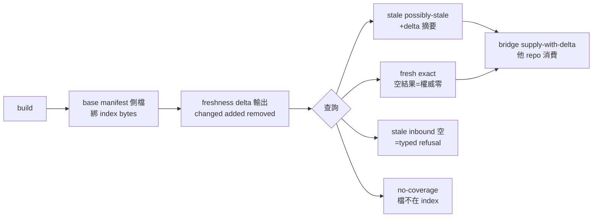

## Description

<!-- SECTION:DESCRIPTION:BEGIN -->
現在的 freshness 是全有全無：任何一個檔案變了，整個 graph 供給就被 skip——docs-only commit 也會讓結構查詢全面退化成 rg（真實浪費案例 job-mv78cymo-qb4r7n）。本弧讓「哪些檔案變了」變成可計算的差集，查詢結果逐筆標註新鮮度等級，並且在 stale 時硬性擋掉「空結果＝不存在」的誤讀。

**做什麼**
- build 時把 governed corpus 的逐檔清單（base manifest）存在 index slot 旁（側檔，與 index bytes 綁定）
- freshness 面輸出差集（changed/added/removed＋完整性判據）
- 查詢面逐筆標註 exact／possibly-stale／no-coverage／indeterminate＋producer 版本
- stale 時 inbound 查詢空結果＝typed refusal（絕不回可誤讀的空 array）
- MCP server 新增唯讀 freshness tool

**不做什麼**
- bridge DB-101/DB-120 契約與 ai-guide AIR-330 措辭（他 repo 主權，本弧只交付契約 fixture）
- git tree object 寫入消費者 repo、autoheal 行為變更

**規矩**
- 詞彙表在本 EP 凍結（與 AIR-330 對齊）；改詞彙＝EP 重開
- 舊 slot／無 manifest 一律降級為「欄位在＋null＋原因」，不誤判 fresh

<!-- SECTION:DESCRIPTION:END -->

## Implementation Plan

<!-- SECTION:PLAN:BEGIN -->
〔baseline：code-reality 1b0ba1e〕

〔已決策勿重辯：①設計＝muse job-mv7hxe3f＋codex job-mv7hxeai 雙顧問收斂版（verdict 檔 .agent-tmp/cr-delta-freshness-{muse,codex}-verdict.md），裁決 D1-D17 全錄 ai-analysis/execution-plans/2026-10-14-cr-delta-freshness/ep.md——manifest diff 當機械真相源（git diff 僅 display）、側檔不入 meta、negative 硬閘、[CR-META]/[CR_VERDICT] 頭行制、graph generation provenance、TOCTOU serving 本體釘定；②規模＝full EP（兩顧問同裁），分段 S2(manifest+delta)/S3(graph provenance)/S4(query gates+MCP)/S5(hand-off)；③詞彙表凍結於 EP（tier 四值＋reason enum＋negative_verdict），改詞彙＝EP 重開；④跨 repo 邊界＝bridge DB-120/DB-101 與 AIR-330 為他 repo 主權，本弧只交付契約 fixture；⑤kill criteria K1（單趟 hash pass 重構）K2（詞彙收斂）錄 EP 段落 0〕

範圍限定：本 repo crates/code-reality（identity/engine/freshness/graph_db/graph_engine/callers/mcp_server/cli）＋tests＋plugin skill 契約節；scripts/lsp_harvest.py 不動（降級承接）。追蹤卡——三張 bounded child（CR-10.1/2/3）各承一段，繼承 EP 已定決策；本卡收全弧結案。
<!-- SECTION:PLAN:END -->

## Implementation Notes

<!-- SECTION:NOTES:BEGIN -->
outbound 台帳：①cr-crdelta-reply-nudge-104913 已受理（acceptanceSeq=10，in_reply_to=aiguide-cr-delta-nudge-20261014，址=delegate-bridge）——催辦回覆：開卡指針＋三對齊錨回執；②cr-crdelta-reply-dborder-104914 已受理（acceptanceSeq=11，in_reply_to=db-crdelta-coderetail-20261014，址=delegate-bridge）——評估結果＋thread 對齊。AUTH: user said「guide 有寄信，請回信」（2026-10-14）。技術註記：duty pin 死鎖一次（首發 draft 缺 schema 欄位即被 pin——pin 寫在 dutymail schema 驗證之前），以 snapshot+pin 對齊修正寄出（內容零變更僅 envelope 格式補欄）；duty_receive pin 先於下游驗證的設計缺口待回饋 ai-guide（另記）。
<!-- SECTION:NOTES:END -->
