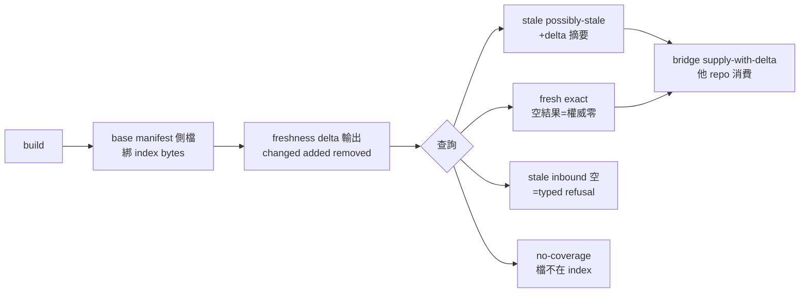

## Description

<!-- SECTION:DESCRIPTION:BEGIN -->
現在的 freshness 是全有全無：任何一個檔案變了，整個 graph 供給就被 skip——docs-only commit 也會讓結構查詢全面退化成 rg（真實浪費案例 job-mv78cymo-qb4r7n）。本弧讓「哪些檔案變了」變成可計算的差集，查詢結果逐筆標註新鮮度等級，並且在 stale 時硬性擋掉「空結果＝不存在」的誤讀。

**做什麼**
- build 時把 governed corpus 的逐檔清單（base manifest）存在 index slot 旁（側檔，與 index bytes 綁定）
- freshness 面輸出差集（changed/added/removed＋完整性判據）
- 查詢面逐筆標註 exact／possibly-stale／no-coverage／indeterminate＋producer 版本
- stale 時 inbound 查詢空結果＝typed refusal（絕不回可誤讀的空 array）
- MCP server 新增唯讀 freshness tool

**不做什麼**
- bridge DB-101/DB-120 契約與 ai-guide AIR-330 措辭（他 repo 主權，本弧只交付契約 fixture）
- git tree object 寫入消費者 repo、autoheal 行為變更

**規矩**
- 詞彙表在本 EP 凍結（與 AIR-330 對齊）；改詞彙＝EP 重開
- 舊 slot／無 manifest 一律降級為「欄位在＋null＋原因」，不誤判 fresh

<!-- SECTION:DESCRIPTION:END -->

## Implementation Plan

<!-- SECTION:PLAN:BEGIN -->
〔baseline：code-reality 1b0ba1e〕

〔已決策勿重辯：①設計＝muse job-mv7hxe3f＋codex job-mv7hxeai 雙顧問收斂版（verdict 檔 .agent-tmp/cr-delta-freshness-{muse,codex}-verdict.md），裁決 D1-D17 全錄 ai-analysis/execution-plans/_done/2026-10-14-cr-delta-freshness/ep.md——manifest diff 當機械真相源（git diff 僅 display）、側檔不入 meta、negative 硬閘、[CR-META]/[CR_VERDICT] 頭行制、graph generation provenance、TOCTOU serving 本體釘定；②規模＝full EP（兩顧問同裁），分段 S2(manifest+delta)/S3(graph provenance)/S4(query gates+MCP)/S5(hand-off)；③詞彙表凍結於 EP（tier 四值＋reason enum＋negative_verdict），改詞彙＝EP 重開；④跨 repo 邊界＝bridge DB-120/DB-101 與 AIR-330 為他 repo 主權，本弧只交付契約 fixture；⑤kill criteria K1（單趟 hash pass 重構）K2（詞彙收斂）錄 EP 段落 0〕

範圍限定：本 repo crates/code-reality（identity/engine/freshness/graph_db/graph_engine/callers/mcp_server/cli）＋tests＋plugin skill 契約節；scripts/lsp_harvest.py 不動（降級承接）。追蹤卡——三張 bounded child（CR-10.1/2/3）各承一段，繼承 EP 已定決策；本卡收全弧結案。
<!-- SECTION:PLAN:END -->

## Implementation Notes

<!-- SECTION:NOTES:BEGIN -->
outbound 台帳：①cr-crdelta-reply-nudge-104913 已受理（acceptanceSeq=10，in_reply_to=aiguide-cr-delta-nudge-20261014，址=delegate-bridge）——催辦回覆：開卡指針＋三對齊錨回執；②cr-crdelta-reply-dborder-104914 已受理（acceptanceSeq=11，in_reply_to=db-crdelta-coderetail-20261014，址=delegate-bridge）——評估結果＋thread 對齊。AUTH: user said「guide 有寄信，請回信」（2026-10-14）。技術註記：duty pin 死鎖一次（首發 draft 缺 schema 欄位即被 pin——pin 寫在 dutymail schema 驗證之前），以 snapshot+pin 對齊修正寄出（內容零變更僅 envelope 格式補欄）；duty_receive pin 先於下游驗證的設計缺口待回饋 ai-guide（另記）。

outbound 台帳續：③cr10-align-reply-110245 已受理（ai-guide acceptanceSeq=10，in_reply_to=aiguide-cr-align-cr10-20261014）——對齊三點確認＋逐段回報改走 ai-guide 本址。④cr9-acceptance-reply-110531 已受理（mosaic_alpha acceptanceSeq=6，in_reply_to=mos-cr9-acceptance-report）——CR-9 驗收回帳＋兩追蹤題答案＋格式閘加嚴詢問。AUTH: user said「先收信，然後再回信」（2026-10-14）。待回覆歸零。

授權記錄（2026-10-14，user 出門前快問快答）：①卡級寄信授權——AUTH: user said「可以，卡級授權」（AskUserQuestion 回答，題目＝弧內對外信全數 inform 性質不承諾時程：S2-S5 逐段回報寄 ai-guide 本址／S4 落地後 bridge+ai-guide 對接信／mosaic CR-9+CR-10 thread 後續討論信）；每信前重驗前提＋記台帳＋card header；預設上限 6 信/72h 先到即終，出卡範圍恆停。②弧內自主 commit 授權——AUTH: user said「可以，弧內自主 commit」——review/judge 綠後 landing commit＋段落分段 commit 自主；push 恆不碰（user 自行執行）。

S2 段收線（commit 94accbe 進 main）：見 CR-10.1 notes。逐段回報信寄 ai-guide（卡級授權第一封）。S3（graph publication provenance）待派。

outbound 台帳續：⑤cr10-s2-report-142833 已受理（ai-guide acceptanceSeq=11，in_reply_to=aiguide-cr-align-cr10-20261014）——S2 段收線回報（③約定第一封；新 thread inform 信走 dutymail send 直呼——reply face 僅及 pending 義務，此用法記錄）。S2 已落地 main：49d023a。

【bridge 更新前 handoff（2026-10-14 15:56，user 要更新 bridge 後開 new session）】S3 中斷點：writer job-mv7smaa9 已乾淨 stop（interrupted），WT code-reality-cr-10.2 保存交付——graph_db.rs +89/-2（D10 五欄 metadata stamp）＋tests/graph_provenance.rs 6 tests 6/6 綠（我機驗過）。剩餘：全量迴歸＋scoped fmt 檢查＋dual review→judge→landing→回報 ai-guide→S4（查詢面標註＋negative gate＋MCP freshness tool——bridge 啟用閘最後碼段）→S5 hand-off。RESUME＝new session 讀本卡＋EP（ai-analysis/execution-plans/_done/2026-10-14-cr-delta-freshness/ep.md）＋.agent-tmp/session-journal.md 尾段；S3 工單＝code-reality-cr-10.2/.agent-tmp/cr10-s3-workorder.md（續派 continuation 或直接進收線——測試已綠可先收線驗證）。授權現值：卡級寄信（6 信/72h，已用 5）＋弧內自主 commit——記錄見本卡前段 notes。

〔S3 收線結算（2026-10-14 17:10，new session 接手收線完成）〕S3 落地
main bfb6c4e（WT daf30e3 rebased→ff）。review 四腿：本地 fresh
needs-fix（F1-F5：input-hash TOCTOU fence、lsp-face placeholder 殘留、
warns 出面、legacy probe、NULL⇒"" 映射）→ 修復批 10 項＋intent accept
（F1-F7，其中 intent 原判 TOCTOU N/A 被 fresh F1 推翻併案修復）→
muse approve 零 findings（job-mv7vf3p4-jde3e6，wonder-1.0 xhigh）→
codex review-fail ×2 顯式降級 bi→single（bridge 3.16.0 codex review
face thread.started 事件流污染——transport 層非額度牆，待 bridge 側
修復或 user 手動 codex 補審）。EP AM-3 已落（canonical byte 編碼＋
NULL⇒"" 映射＋lsp-harvest residual＋出版 drift fence＋S4/S5 對照表
義務）。驗證：scoped lib 66/66＋6/6、全量 --no-fail-fast 72 suites
730/0、rust_backend flake 證實併發負載（安靜重跑 4/4）。judge
converged: accept。CR-10.2 卡結算已寫、Done 翻牌留 user。下一步＝
S4 開工（cr-10.3）。寄信額度本回報後用罄（第 6 封）。

outbound 台帳續：⑥cr10-s3-report-171645 已受理（ai-guide
acceptanceSeq=12，deliverySeq=12）——S3 段收線回報（卡級授權末封；
新 thread inform 走 dutymail send 直呼；首封 envelope 因 heredoc 轉義層
`\0` 非法 escape 被 usage class 拒收零外流，改 Write 面重造後過——
idempotency 未觸發）。寄信額度 6/6 用罄、72h 授權面照約終止：S4/S5
段回報改 journal＋user 報告承載，如需寄信須 user 重新授權。

〔S4 commit gate（2026-10-14，user 回話）〕AUTH: user said「bi
post-build OK 就可以 commit」——S4 收線 review＝bi panel（muse＋codex；
codex 腿照塌縮前置判準換新 diff 重測一次，再現同 transport 簽名即
single＋顯式記錄），review OK 即 landing commit（併入弧內自主 commit
授權面）；push 恆不碰。

〔Done 翻牌授權（2026-10-14 晚，user 回話）〕AUTH: user said「你做好就
翻done, 不用等我」——弧內卡（CR-10.1/10.2/10.3）工作落線＋結算完整即
由 marshal 自行翻 Done 免逐張請示；翻牌前提不變（review/judge 綠＋
landing＋結算寫入），條件不滿足不翻。父卡 CR-10 收案仍待 S5 完成。

〔S4 收線結算（2026-10-14 20:35）〕S4 落地 main `5a7e3f2`＋`85c520e`
（cr-10.3 rebase 後 ff）。四腿審查（fresh/intent＋muse＋codex task-face）
→ judge R1-R15（codex 4🔴 全親驗）→ 修復批 job-mv803hiw → muse 複審
5 項（F1 high：post-load rebind 臂不健全——裁定 mismatch 一律降級）
→ round-3 微修 → converged: accept。驗證：684/0＋fmt＋post-merge
main 綠。CR-10.3 已翻 Done（依上授權）。誠實未決項（S5 前裁決）：
①TC-14 graph_query 劣化閘本語料 FAIL（heal/stamp 雙評估優化候選）
②R11 scip stale 基底跨平面耦合 semantic split 候選。bridge 3.16.0
回饋包（workspace-mismatch 誤分類＋codex review face 污染＋reviewer
寫檔偏差）待整理回饋 bridge repo。**剩餘＝S5 hand-off**（契約 fixture＋
S5 對照表＋bridge wrapper pin 對齊＋ai-guide 對接——寄信額度已罄，
對接信需 user 重新授權）。

outbound 台帳續：⑦cr-bridge-feedback-204439 已受理（delegate-bridge
址 acceptanceSeq=12，deliverySeq=12）——bridge 3.16.0 回饋包三項
（①status.rs:285 workspace-mismatch 關鍵詞誤判 Rust test-output 新變體
②codex review face thread.started＋SessionEnd hook 訊息污染③唯讀工單
下 codex reviewer 自建報告檔觀察）。AUTH: user said「寄信給bridge」
（逐次授權——非卡級 6 信額度面，該額度仍為已罄狀態）。

〔S5 收線結算＋弧收案（2026-10-14 深夜，deep-work）〕S5 交付全落：
①契約 fixture `ai-analysis/execution-plans/_done/2026-10-14-cr-delta-
freshness/contract-fixture-v1.md`（十面逐字機驗 capture——lab 面
fresh-exact/possibly-stale/no-coverage/D7 硬閘 refusal/freshness JSON
＋primary dogfood 面＋MCP get_community/freshness tool/manifest 22 工具
digest）②消費者對照表（fixture §5：graph client 第二行插入、scip 家族
[CR_VERDICT]、get_community face 變更、工具數 21→22）③兩信已寄受理：
ai-guide `cr10-s5-air330-probe-212025`（seq14，AIR-330 K2 詞彙 probe——
衝突回信機制在場）＋bridge `cr-bridge-d101-212025`（seq13，DB-101 對接
面）。④wrapper pin 對齊：plugin_wrapper_regression 綠（0.13.0 釘面
一致）。⑤repo AGENTS.md Capabilities 補標註面列＋freshness row
「MCP carries no freshness tool」drift 修正。⑥EP 歸檔 `_done/`（引用
五檔同步改寫）。judge 裁決物（AIR-135.9 四欄）：TC-14 劣化閘 FAIL→
verdict=keep-disclosed（理由：方向安全、優化屬獨立 perf 卡；拒絕選項：
本弧內優化——風險＞值；可逆性：優化卡候選在案）；R11 語義 split→
verdict=keep-disclosed（理由：跨平面耦合是 EP 設計、semantic 變更需
獨立審查弧；拒絕選項：本弧內 split；可逆性：候選在案）。兩者皆記 EP
進度節＋本卡＝S5 後續候選，晨間 triage 決定開卡與否。
**弧終態：CR-10.1/10.2/10.3＋本卡全 Done。** 後續候選（非債）：TC-14
優化卡、R11 semantic-split 卡、PyPI 下一版 release（user 排程）。
<!-- SECTION:NOTES:END -->
