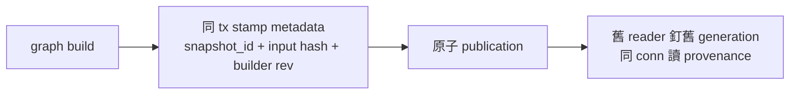

## Description

<!-- SECTION:DESCRIPTION:BEGIN -->
delta-freshness 第二段：graph.db 出版時蓋 generation 身分章。

**做什麼**
- graph build 在同一 publication tx 內 stamp metadata：graph_snapshot_id（sha256 構造式）、input_index_sha256、source_manifest_digest、builder_revision（build 當下版號，非查詢時版號）、coverage
- 查詢時 provenance 必須從「實際開著的那個 connection」讀（不是重讀路徑——TOCTOU 防線的出版側）

**不做什麼**
- 查詢面消費這些 metadata（S4 段）；legacy db 的 indeterminate 語義也在 S4 落

**規矩**
- git_head_sha 維持 display 軸，禁作 provenance 鍵（docs-only commit 會讓 head 與 graph 身分脫鉤）

<!-- SECTION:DESCRIPTION:END -->

## Implementation Plan

<!-- SECTION:PLAN:BEGIN -->
〔baseline：依 CR-10.1 落地線；parent＝ai-analysis/execution-plans/2026-10-14-cr-delta-freshness/ep.md 段落 S3＋D10/D11 決策錨〕

〔已決策勿重辯：①graph_snapshot_id＝sha256(source_index_sha256‖builder_revision‖schema_version) hex，同 publication tx stamp；②builder_revision＝build 當下 CR_BUILD_REV（編譯期常數），禁查詢時版號充數；③git_head_sha 維持 display 軸不作 provenance；④legacy db 無 key→S4 面 indeterminate，本段只管出版；⑤provenance 讀取必同 conn（S4 消費側紀律）〕

範圍限定：graph_db.rs＋tests；TC-11＋concurrent generation 對帳。
<!-- SECTION:PLAN:END -->
