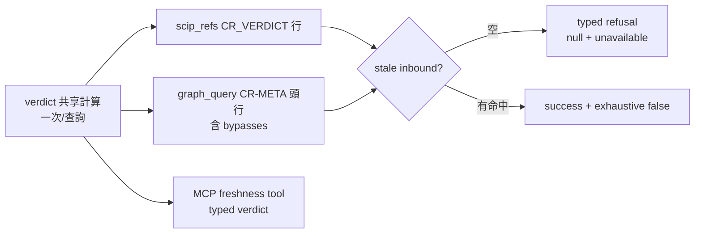

## Description

<!-- SECTION:DESCRIPTION:BEGIN -->
delta-freshness 第三段（收碼段）：查詢面逐筆標註＋stale negative 硬閘。

**做什麼**
- scip_refs 家族：[SRC] 保留第一行，第二行加 [CR_VERDICT] 標註（freshness tier／exhaustive／delta 摘要，出自 verdict 計算非 source_line）
- graph_query 12 op：stdout 第二行加 [CR-META] JSON 頭行（Array 型 op 也能標註；symbols early-return 與 MCP get_community 旁路都補上）
- stale＋inbound＋空結果＝typed refusal（null＋negative_verdict=unavailable；MCP is_error=true；CLI 非零 exit）——可誤讀的空 array 從型別上消滅
- MCP 新增唯讀 freshness tool（stale=exit1 是合法 verdict，is_error=false；s6 釘數 21→22；digest 變更獨立 commit）
- TOCTOU：標註只從實際 serving 本體派生（ServingStamp／同 conn metadata）

**不做什麼**
- bridge 啟用與 AIR-330 措辭（S5 hand-off；CR suite 綠 ≠ 啟用授權）

**規矩**
- 詞彙凍結自 EP；truncation 時 negative／complete 結論 fail-closed（絕不輸出成功半份 JSON）

〔S4 結算（2026-10-14 晚）〕landing main `5a7e3f2`＋`85c520e`
（b67153c＋修復批 rebase 後 ff）。review 四腿（fresh/intent 本地＋
muse `job-mv7z4sve`＋codex task-face `job-mv7z5kbz`——review face 撞
web 池 28K 閘，照判準降 payload 重派成功）→ judge 合流 R1-R15
（codex 4🔴 全親驗實錘：查詢面 TOCTOU 視窗、partial-binding exact、
negative gate 被 delta 短路、bfs_skipped 不進 verdict）→ 修復批
`job-mv803hiw`（glm flash）→ muse 複審 5 項（F1 high：post-load
rebind 臂描述未載入 bytes——裁定 mismatch 一律降級，rebind 拔除）→
round-3 微修（symbols face post-load recheck、quote 條件補雙引號、
EP 註記改持久引用）→ **converged: accept**。驗證：全量 51 suites
684/0＋fmt 乾淨＋post-merge main 綠。帳本＝cr-10.3 WT
`.review/cr-10.3.md`。誠實未決項（EP 進度節＋S5 前裁決）：①TC-14
graph_query 劣化閘本語料 FAIL（heal/stamp 雙評估，優化候選）；②R11
scip stale 基底跨平面耦合 semantic split 候選。bridge 3.16.0 兩項
故障（workspace-mismatch 誤分類、codex review face thread.started
污染）已記 bridge 側回饋包。Done 翻牌依 user 授權（AUTH「你做好就
翻done, 不用等我」）。
<!-- SECTION:DESCRIPTION:END -->

## Implementation Plan

<!-- SECTION:PLAN:BEGIN -->
〔baseline：依 CR-10.1/10.2 落地線；parent＝ai-analysis/execution-plans/2026-10-14-cr-delta-freshness/ep.md 段落 S4＋D6-D9/D11-D14 決策錨〕

〔已決策勿重辯：①[CR_VERDICT] 第二行制（資料出自 verdict 計算非 source_line；golden 更新＝明示契約決策）；②[CR-META] 頭行制（Array op 可標註；symbols early-return＋get_community MCP 直呼兩旁路補齊；gq_fail 無行＝不推論 fresh）；③negative 硬閘＝stale inbound 空結果 typed refusal（null＋unavailable；MCP is_error=true；CLI 非零）——正面命中照回 exhaustive=false；④MCP freshness tool typed verdict（stale is_error=false；s6 釘 21→22；digest commit 獨立段尾）；⑤truncation fail-closed＝TRUNCATED_UNVERIFIED；⑥TOCTOU＝ServingStamp＋同 conn metadata，mismatch→retry 一次→indeterminate〕

範圍限定：engine.rs/callers.rs/graph_engine.rs/mcp_server.rs＋tests（s5/s6）；TC-4/5/6/9/10/13。
<!-- SECTION:PLAN:END -->
