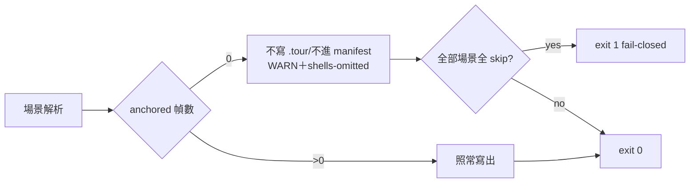

## Description

<!-- SECTION:DESCRIPTION:BEGIN -->
mosaic CR-9 驗收 thread 的 B 面需求（user 原話「A+B 併做」——A 已由
mosaic 語料面完成並回執，B＝本 repo 的 chain_tour 格式閘加嚴）。信源：
cr9-gate-requirement-20261014（mosaic-alpha-zcode，2026-10-14）。

**做什麼**（mosaic 提案全文照錄——規格已由消費端定稿）
- 場景內可解析（anchored/graph-resolved）幀數＝0 時：**不寫 .tour 檔、
  不進 manifest**，改印顯式 [WARN]（族名＋場景標題＋幀數＋skip 原因
  分佈），summary 統計行加 `shells-omitted` 計數。
- exit 語義：部分場景正常寫出 → 維持 exit 0（殼省略是語料事實不是工具
  失敗）；整份 md 所有場景皆全 skip → 併入既有 (a) 形 exit 1
  fail-closed（不另立第三態）。
- **不採幀數下限**：會誤傷合法小場景（1-2 幀真錨場景存在，如 mosaic
  族 04.tour 2 步）——「全 skip」才是殼的精確判準。

**已知後果（mosaic 端已接受）**：63-夜間維運序列族（幀全為
deploy/scripts shell 面）整族四條皆殼形——閘落地後下次重產該族將零
tour（md 保留為敘事文檔），mosaic 視為正確行為。

**不做什麼**
- 幀數下限閘、其他 chain_tour 語義變更。

<!-- SECTION:DESCRIPTION:END -->

## Implementation Plan

<!-- SECTION:PLAN:BEGIN -->
〔baseline：依 CR-10 落地線；需求源＝mosaic 信逐字規格（上錄），禁
擴面。驗證：TC 沿 mosaic 信三態（全 skip→不寫＋WARN＋exit 1；部分→
exit 0＋shells-omitted 計數；正常→行為不變）＋既有 tour corpus 迴歸
（tour_validate 0 fails）＋mosaic 端回執驗收（消費者語料 224 tours
現狀重產對照）。〕
<!-- SECTION:PLAN:END -->
