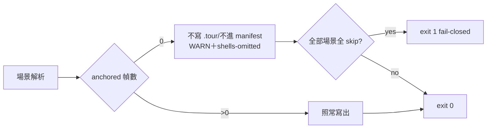

## Description

<!-- SECTION:DESCRIPTION:BEGIN -->
mosaic CR-9 驗收 thread 的 B 面需求（user 原話「A+B 併做」——A 已由
mosaic 語料面完成並回執，B＝本 repo 的 chain_tour 格式閘加嚴）。信源：
cr9-gate-requirement-20261014（mosaic-alpha-zcode，2026-10-14）。

**做什麼**（mosaic 提案全文照錄——規格已由消費端定稿）
- 場景內可解析（anchored/graph-resolved）幀數＝0 時：**不寫 .tour 檔、
  不進 manifest**，改印顯式 [WARN]（族名＋場景標題＋幀數＋skip 原因
  分佈），summary 統計行加 `shells-omitted` 計數。
- exit 語義：部分場景正常寫出 → 維持 exit 0（殼省略是語料事實不是工具
  失敗）；整份 md 所有場景皆全 skip → 併入既有 (a) 形 exit 1
  fail-closed（不另立第三態）。
- **不採幀數下限**：會誤傷合法小場景（1-2 幀真錨場景存在，如 mosaic
  族 04.tour 2 步）——「全 skip」才是殼的精確判準。

**已知後果（mosaic 端已接受）**：63-夜間維運序列族（幀全為
deploy/scripts shell 面）整族四條皆殼形——閘落地後下次重產該族將零
tour（md 保留為敘事文檔），mosaic 視為正確行為。

**不做什麼**
- 幀數下限閘、其他 chain_tour 語義變更。

<!-- SECTION:DESCRIPTION:END -->

## Implementation Plan

<!-- SECTION:PLAN:BEGIN -->
〔baseline：依 CR-10 落地線；需求源＝mosaic 信逐字規格（上錄），禁
擴面。驗證：TC 沿 mosaic 信三態（全 skip→不寫＋WARN＋exit 1；部分→
exit 0＋shells-omitted 計數；正常→行為不變）＋既有 tour corpus 迴歸
（tour_validate 0 fails）＋mosaic 端回執驗收（消費者語料 224 tours
現狀重產對照）。〕
<!-- SECTION:PLAN:END -->

## Notes

<!-- SECTION:NOTES:BEGIN -->
### 結算（2026-10-15，Done flip）

**Landing**：main `a1ad685`（自 `4ba2f7b` ff，5 commits：`6193553` feat 閘＋
四輪修復 `beacb79`/`d1def32`/`4370dce`/`a1ad685`）。Post-merge 全量
`cargo test -p code-reality` 52 binary 全綠。

**交付面**（規格照 mosaic 信逐字）：
- 場景級全 skip＝殼：不寫 .tour、不進 manifest；partial 殼 → exit 0＋
  stderr 逐場景 [WARN]（族名＋標題＋幀數＋原因分佈）＋summary
  `shells-omitted` 計數；全殼 md → 併入既有 (a) 形 exit 1 fail-closed
  零寫入（gated stdout 保留）。無幀數下限（2 幀真錨合法釘測試）。
- 審查四輪增補（雙腿 findings 合併，全 RED→GREEN）：regen 殘留清退
  （generator 擁有面、rows 先持久化、`.tour` 限定、失敗降 WARN 孤兒
  良性態）；`--primary` 回歸原 md 場景序＋殼位 loud FAIL；全殼既有族
  殘留揭露；tour_manifest::dump 原子化（temp 獨佔建立＋fsync＋rename
  ——共享 dump，chain_tour/register/materialize/init_scan 全受益，
  POSIX rename 邊界釘測試）；tool-facts SKILL.md 同步。

**驗收鏈**：writer glm flash（job-mv8jxu1z，TDD 4 測 RED→GREEN）→
bi review（muse `failed-usage` 降級 bi（muse→flash）；codex job-mv8l2w1s
NEEDS-FIX 2 Major＋flash fresh-eyes ACCEPT 3 minor 2 nit，兩腿機制同、
定級分歧）→ fix/re-review 四輪（job-mv8lwz8j／mv8nbwxo／mv8o39rt/
mv8owxmr；codex 同 session followup，round 5 **ACCEPT**——NF5 Resolved
Major、121 測 0 failed、M1 minor 不擋）→ landing。

**後續項（不開卡，隨手可修）**：M1——UchgGuard skip path 在不 enforcement
uchg 的檔案系統上 Drop 斷言可能 panic（codex round 5，minor/static-only，
僅測試可攜性）。

**PENDING（等 user 授權）**：mosaic 回執完成信（卡級信額度 6/6 用罄）；
mosaic 端 224-tour 重產對照＝消費者回執驗收面。

<!-- SECTION:NOTES:END -->
