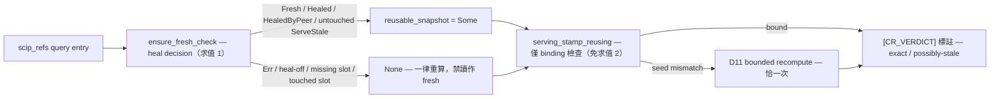

# CR-12 — TC-14 heal/stamp 雙評估消除（方案 A：串流快照）

## Problem

Default 查詢路徑上同一份 staleness 評估跑兩遍：cli.rs heal 檢查（~:330-361，
內含完整 evaluate_staleness → needs_rebuild 決策）之後 `serving_stamp`
（~:392）再跑一次完整評估（全 source walk＋identity＋delta＋identity-cache
WriteBack）。TC-14 實測：NT 本語料 warm 86ms 及格，但加標註劣化 >20%。

**歸因修正（codex 討論反證，已採納）**：graph_query 不走 cli.rs heal 流程
（main.rs:31 → graph_engine::run 自建 stamp，graph_engine.rs ~:2514，無
ensure_fresh）——本卡只消除 **scip_refs fresh path 的重複求值**；
graph_query 標註成本是單次求值的固有成本，不在本卡 scope（見 Out of scope）。

## Plan A（方向已由 user 裁定；設計經 codex 討論 refine，2026-10-15）

- **②① plumbing**：load-face 返回值形——`HealCheck { outcome: HealOutcome,
  reusable_snapshot: Option<StalenessSnapshot> }`（HealOutcome 四態已封裝於
  build.rs ~:1275）；stamp 側新增可接受 snapshot 的建構入口。
  **None ＝ 重算，禁解讀為 fresh**（HealOutcome::Fresh 涵蓋 slot 缺席）。
- **②② per-outcome 快照語義**：Fresh → 原快照可重用；Healed →
  run_heal_locked 的 post-build 重算結果（build.rs ~:1491 已存在）；
  HealedByPeer → lock 釋放後重算結果（build.rs ~:1611 已存在）；
  ServeStale → 保守重算除非 slot 可證未變；Err → 無快照（D15 降級流程不變）。
  stamp-time 與 post-load binding 檢查全保留（freshness.rs ~:300/~:398）。
  D11 bounded consistency 不變（禁宣稱 ABA linearization）。
- **②③ single-flight**：等待 peer 後用 post-wait 重算快照，禁沿用等待前
  快照；逾時/接管按實際結果。

## AC（驗證協議）

- 閘（NT 本 repo 自食實測，S2 AM-2 慣例）：freshness warm ≤200ms；
  **scip_refs 標註 p50 劣化 <20%（修正後）**；fresh query 恰一次完整
  staleness 求值（求值次數計數證據）；heal/peer-heal stamp 綁實際 serving
  generation；cold 記錄數值不設門檻。
- 量測協議：固定 corpus／index hash／release binary／identity-cache warm，
  交錯 baseline/candidate 各 ≥50 次，記 p50/p95＋求值次數。
- graph_query 標註：分開量測歸因（單次求值為固有成本），本卡不設 <20% 閘。

## Out of scope

evaluate_staleness 本身的成本優化；graph_query 標註路徑提速（若量測後仍
劣化屬 disclosed residual，另議卡）。

## Scope fence

cli.rs（heal 塊＋兩查詢入口）、freshness.rs、heal 模組（build.rs）簽名串接；
graph_engine.rs 僅在快照串接必要處觸碰。契約面（fixture）不在本卡。

## Implementation Notes

<!-- SECTION:NOTES:BEGIN -->
2026-10-15 晨：WT 開立（code-reality-cr-12，branch cr-12＝main@aa7ef22）；開工 commit f1ef8ea；工單 wo-cr-12.md 已進 WT .agent-tmp/；writer 已派（bridge glm GLM-5.3-Flash yolo --wt --card CR-12，jobId job-mv8qh48o-b9927m，bridge_waiter 配對 exec_0e53154a）。WT 內 CR index 未建（mcp-supply probe-unavailable skip——writer 直讀源碼不受影響）。回收後流程：機驗（cargo test 全套＋fmt）→ review bi（muse 腿先 probe）→ judge。

2026-10-15 review round 1：機驗全綠（rustfmt 5/5＋cargo test exit 0＋量測四閘過——標註劣化 -0.1%/+0.3% vs 閘 20%、freshness warm 69ms、fresh 恰一次求值、cold 已記）。panel 降級記錄：bi→muse failed-usage（額度）＋codex web turn 失聯 2/2（stream disconnected，relay 6.1.9 健康非暫態）→flash fresh-eyes（in-harness）＋judge 主 session。fresh-eyes ACCEPT：七軸查證過（None≠fresh、無 false-clean、D11 等價）。F1 engine.rs 計數器＝ACCEPT 偏差（AC 求值證據唯一取得點，記錄於此）；F2(a) lock-Err 借出＝disclosed residual 無測試；F3/F4/F5 無動作。F2(b) 半成功 Healed 臂缺 HealCheck-face 斷言→fix 輪已派（resume writer session，job-mv8tsbag-7n1prt）。mail 側：db126 bridge 3.17.0/3.18.0 出貨知會已讀（無需回覆）。
<!-- SECTION:NOTES:END -->

## Final Summary

<!-- SECTION:FINAL_SUMMARY:BEGIN -->
TC-14 closed: scip_refs fresh path now runs the full staleness evaluation exactly once per query — HealCheck{outcome, reusable_snapshot} threads the heal check's snapshot into serving_stamp_reusing (None always means recompute, never fresh); per-outcome lending (Fresh/Healed/HealedByPeer lend, ServeStale lends only on untouched-slot short-circuits, Err lends nothing), single-flight lends post-wait only; D11 bounded retry and both binding legs unchanged. Measured (release, A/B/C interleaved n=60, fixed index): scip_refs annotation degradation +60.3% → −0.1% (gate <20%), freshness warm ~69ms (gate ≤200ms), cold recorded; graph_query annotation +440% attributed as inherent single-evaluation cost (A/B identical — separate-card candidate). 713 tests green incl. heal_stamp_snapshot.rs count-assertion suite + t17b half-success assertion; review fresh-eyes ACCEPT (7-axis), F1 counter deviation accepted, F2b fixed. Landed f74dc0d (linear, ff). Panel degradation recorded: muse quota-exhausted + codex web turn-death 2/2 → in-harness flash fresh-eyes + main-session judge.

終態圖（as-built）：

<!-- SECTION:FINAL_SUMMARY:END -->
