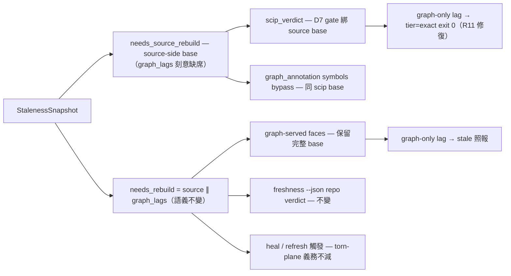

# CR-13 — R11 scip stale 基底 reason-set 分軸（方案 A：typed predicate）

## Problem

`engine.rs` needs_rebuild()（~:950-958）含 `graph_lags`（torn-plane：canonical
graph.db 缺失/滯後）。scip index 內容新鮮但 graph.db 滯後時，scip 查詢被誤標
stale／誤觸 D7 refusal（暴露面：explicit `--index`、AUTOHEAL=off、heal 失敗
路徑）。False refusal＝availability 損失非正確性。

**實現方式修正（codex 討論反證，已採納）**：禁用 stale_reasons 字串集交集——
部分 reason 在 identity mode 非 fatal（診斷值≠fatal 條件）。改 typed
predicate 單一源；公開 stale_reasons 詞彙不變（診斷照報、fatal 判定改由
predicate 決定）。

## Plan A（方向已由 user 裁定；設計經 codex 討論 refine，2026-10-15）

- **typed predicate 單一源**：`StalenessSnapshot` 增 `needs_source_rebuild()`
  ＝ identity_algo_upgrade ‖ identity_drift ‖ (identity_drift.is_none() &&
  (source_newer ‖ doc_set_drift ‖ corpus_policy_drift))（欄位型別照實際）；
  `needs_rebuild()` ＝ `needs_source_rebuild() || graph_lags`。
- **per-face 語義**：`scip_verdict` 用 needs_source_rebuild()；
  `graph_annotation` 的真 graph-served 分支保持完整 needs_rebuild()；
  freshness --json 的 repo-level verdict 不變。
- **torn-plane 歸屬（已裁定）**：canonical graph.db 缺失/滯後不算 scip-face
  stale（scip 面不消費 graph.db；cli.rs refs/defs/callers 讀 SCIP，
  僅 --audit 讀 graph.db）；engine.rs ~:950 的 torn-plane **重建觸發不動**。
- **symbols bypass 對齊（進 AC）**：graph_query symbols 直接消費 SCIP 卻用
  graph_annotation（freshness.rs ~:607 稱其 semantically scip-face）——
  改用 source-side 語義與 scip_refs 一致；真 graph-served 分支不動。

## 契約與文檔義務

- **fixture v1.1**：v1（`_done/2026-10-14-cr-delta-freshness/contract-fixture-v1.md`）
  不可變；新增 v1.1 supplemental 節：per-face stale-base 對照表＋
  graph-only torn-plane 實輸出 fixture。**誠實披露＝語義契約修訂**
  （v1 §2.3 把 gate 綁 needs_rebuild()）非純 additive。
- **消費端披露（PENDING——信件需 user 逐次授權）**：ai-guide AIR-330＋
  bridge DB-120/DB-101——unavailable 字面值與錯誤處理不變、scip-face
  觸發集縮小、graph-only torn-plane 下 scip 查詢返回 source-exact 而
  freshness --json 仍報 repo stale。

## 測試落點（codex 建議，採納）

- freshness.rs ~:780：source-fresh/graph-lags-only vs source-stale 的 D7 單元案。
- query_freshness_annotation.rs ~:279：callers/closure、--index、AUTOHEAL=off
  端到端對照。
- source_identity.rs ~:338：保留 torn-plane 仍令 freshness stale＋heal 觸發
  的既有斷言。
- mcp_freshness_tool.rs ~:130：source-stale refusal 仍折疊
  `stale-negative-unavailable`；graph-only 不再折疊。

## Scope fence

engine.rs（predicate＋needs_rebuild 組合）、freshness.rs（scip_verdict／
symbols 語義）、contract-fixture v1.1 節；cli.rs 僅 D7 相關；graph_annotation
graph-served 分支不動。

## Implementation Notes

<!-- SECTION:NOTES:BEGIN -->
2026-10-15：WT 開立（code-reality-cr-13，branch cr-13＝main@6044ca8——含 CR-12 已落地地形）；開工 commit；工單已進 WT .agent-tmp/。PENDING 保持：消費端披露信（AIR-330＋DB-120/DB-101）需 user 逐次授權，弧內不寄。

2026-10-15 review round 1：writer 交付（typed predicate＋per-face＋fixture v1.1＋四落點 RED→GREEN）。機驗中：全套測試背景跑；judge 親讀——predicate 組合與卡公式逐字吻合、needs_source_rebuild 機械反查恰 4 非測試點（def/組合/scip_verdict/Bypass）、既有 needs_rebuild 消費端（freshness face/ServingStamp::fresh/build.rs heal）全保留 torn-plane、cli.rs 零動、fixture §1-6 純插入機驗＋§7 誠實披露＋§8 表與碼一致。panel 再塌縮：muse failed-usage（窗口未重置）＋codex failed-or-capped（3rd 同形 turn 死）→flash fresh-eyes（在審）＋judge 主 session。

2026-10-15 round 1 裁決：機驗全綠（cargo test exit 0＋rustfmt 5/5＋無 debug 殘留）＋flash fresh-eyes ACCEPT（八軸零 Major）。F1 卡檔 base-skew＝結構性已解（commit 範圍僅 6 scope 檔，rebase 乾淨吸收）；F3 fixture §8 列缺 defs 用詞→fix 輪已派（resume，job-mv8wdgsm-oxd9i9）；F2 env panic 洩漏＝既有 house pattern 非新引入、F4 heal 失敗路徑傳遞性覆蓋與卡落點一致——皆無動作記錄。
<!-- SECTION:NOTES:END -->

## Final Summary

<!-- SECTION:FINAL_SUMMARY:BEGIN -->
R11 closed: the scip face (refs/defs/callers/closure + graph_annotation symbols bypass) now resolves its stale base from the typed predicate needs_source_rebuild() — a graph-only torn plane (slot fresh, canonical graph.db missing/lagging) answers source-exact (tier=exact, exit 0) instead of false-refusing (R11 availability loss); needs_rebuild() = needs_source_rebuild() || graph_lags keeps every existing consumer intact — graph-served faces, freshness repo verdict, and the heal/refresh rebuild triggers keep the unconditional torn-plane guard. Public stale_reasons vocabulary unchanged (diagnostic only); cli.rs untouched. contract-fixture-v1.md gained the v1.1 supplemental section: honest semantic-revision disclosure (v1 §2.3 gate binding revised, NOT purely additive — consumer-visible delta table), normative per-face stale-base table, machine-captured both-face outputs on the graph-only torn plane. PENDING (user-gated): consumer disclosure letters (ai-guide AIR-330 + bridge DB-120/DB-101 — scip-face trigger set narrowed; unavailable literal and error handling unchanged). 713-test suite green incl. 5 new + tc13 split assertion; fresh-eyes ACCEPT (8 axes, 0 Major), F3 wording fix landed. Landed 25e738d (linear, ff). Panel degradation recorded: muse quota + codex web 3rd turn-death → in-harness flash fresh-eyes + main-session judge.

終態圖（as-built）：

<!-- SECTION:FINAL_SUMMARY:END -->
