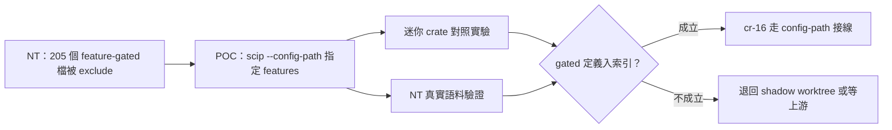

## Description

<!-- SECTION:DESCRIPTION:BEGIN -->
NT fork 反映：205 個 feature-gated Rust 檔（python/capnp/arrow 等 non-default feature 模組）永遠進不了 code-reality 索引——rust-analyzer scip 只用 default features 產索引，NT 只好把這些檔 exclude。本卡做一個 POC：用上游 scip CLI 既有的 `--config-path`（JSON 設定檔）指定 cargo features，驗證 gated 檔能不能進 SCIP 索引。成立與否決定後續 producer 接線卡（cr-16）走哪條路。

<!-- SECTION:DESCRIPTION:END -->

## Acceptance Criteria
<!-- AC:BEGIN -->
- [ ] #1 迷你 crate 正反對照：default features 下 gated 定義缺席、--config-path 指定 feature 後出席
- [ ] #2 NT 1.99.0 真實語料：至少 python feature 群 gated 檔（例 crates/adapters/betfair/src/python/config.rs）出現在 SCIP 產物
- [ ] #3 config JSON 形狀依官方文件（cargo.features 巢狀、去 rust-analyzer. 前綴），實驗命令與產物差異留證據
- [ ] #4 結論（成立/不成立/條件成立）＋證據落卡 notes，供 cr-16 EP 引用
<!-- AC:END -->

## Implementation Plan

<!-- SECTION:PLAN:BEGIN -->
〔baseline：code-reality 6e2dcde〕
〔已決策勿重辯：①NT 已實驗證實 rust-analyzer scip 不吃 repo-root rust-analyzer.toml、無 --features flag（receipt：nautilus_trader ai-analysis/reports/rc7-upgrade/RECEIPT.md）；②--config-path 旗標存在於上游源碼與 NT toolchain 1.99.0（codex 討論 job-mvc9qrg8 查證）；③config JSON 官方形狀＝rust-analyzer.cargo.* 去前綴巢狀（cargo.features／cargo.noDefaultFeatures）；④POC 通過條件＝SCIP 產物出現 gated 定義（非 exit 0——config 套用失敗只走 logging 有靜默風險）；⑤shadow worktree 第二腿＝最後備援非首選〕
範圍：迷你 crate 對照（default vs config-path）＋NT 語料單 feature 群（python）驗證；產出與暫存一律放 /tmp，不改 CR 與 NT 兩 repo 任何追蹤檔；結論（成立/不成立＋證據）落卡 notes，餵 cr-16 EP。
<!-- SECTION:PLAN:END -->
