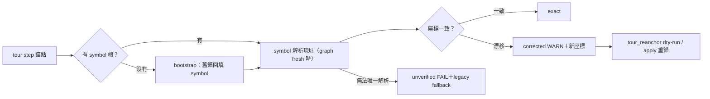

## Description

<!-- SECTION:DESCRIPTION:BEGIN -->
NT fork 的 110 個 tour 在 merge 之後行號漂移，現行驗證（tour_validate）只靠 file＋行號＋regex 對工作樹對答案，漂移後只能靠最近命中手修。本卡把驗證與重錨改用 SCIP symbol 當錨點身份：tour step 已內建 symbol 欄（x-codeReality.symbol），缺 symbol 的舊 tour 先安全回填（bootstrap），再以 symbol 解析現址——symbol 找得到但行號舊了回 WARN 提示新座標，重錨走獨立 dry-run/apply 流程，不動 tour 的出處紀錄（provenance）。

<!-- SECTION:DESCRIPTION:END -->

## Acceptance Criteria
<!-- AC:BEGIN -->
- [ ] #1 legacy .tour 在無 fresh index 時維持現行 file/line/pattern 驗證行為
- [ ] #2 fresh index 下：座標已更新且一致＝exact；symbol 唯一但座標舊＝corrected WARN 帶新座標；無法唯一解析＝unverified FAIL＋legacy fallback，不得盲選 nearest
- [ ] #3 CR-9 R1/R2/R3 可適用語義經共用 resolver 保留
- [ ] #4 bootstrap：legacy 錨→唯一 SCIP symbol 回填；無法唯一確認者保留人工處理不強填
- [ ] #5 committed-baseline／stale graph 不執行自動重錨；對外語義沿用既有 freshness/CR_VERDICT 詞彙
- [ ] #6 tour_reanchor 預設 dry-run 零寫入；--apply 只改已驗證 step，不動 generator/sources/anchored_commit/未知欄位
- [ ] #7 apply 後 tour_validate 全過且 CodeTour player 可正確導航
- [ ] #8 NT 110 tours 全量跑出修正/跳過/歧義統計，不隱藏 unresolved
<!-- AC:END -->

## Implementation Plan

<!-- SECTION:PLAN:BEGIN -->
〔baseline：code-reality 6e2dcde〕規模＝standalone EP（full tier——實作計畫唯一源＝EP，開工時 references 指回；本卡 Plan 只留已決策與範圍）。
〔已決策勿重辯：①生成側 CR-7/CR-9 已出貨（chain_tour line-less 回填＋同檔同名歧義消解），本卡是驗證/重錨側，勿重做生成側；②三態語義保留——symbol 解析成功≠exact（CodeTour player 實際消費 file/line/pattern），symbol 唯一但座標舊＝corrected WARN 帶新座標，解析不出＝unverified FAIL＋legacy fallback；③重錨走新 tour_reanchor 面（dry-run 預設、--apply 只動已驗證 step、保留 generator/sources/anchored_commit），禁擴充 tour_upgrade --apply（它會把 generator 改 manual、anchored_commit 改 HEAD——抹 NT 三世代 provenance）；④freshness gating：serves=current-tree 才允許 symbol 解析；committed-baseline 退回 line/pattern 驗證並明示 stale；stale graph 禁自動 apply；對外沿用既有 freshness/CR_VERDICT 詞彙不造新 verdict；⑤bootstrap 保守——graph nodes 的 line_start==line_end 不可當 enclosing range（graph_db.rs:919-939，須用 SCIP occurrence/spans），唯一且語義可驗證才回填、歧義走消解、不可驗證留人工，nearest-line 不得偷升級為權威；⑥CR-9 復用＝抽共用 resolver（同檔候選集合／R1 pseudo-ctor canonicalization／R2 限定名唯一判定／R3 ambiguous hints），tour_validate 不直呼 chain_tour 的 fill_anchor（輸入契約不同）；⑦NT 110 個 .tour 實測零 x-codeReality（rc7 前時代產物），bootstrap 是本卡主體成本；⑧symbol 也會漂（module path／定義所有權變動），lookup miss 走 fallback、禁自動推定原定義已刪〕
範圍：tour_validate symbol 解析＋tour_reanchor 新面＋legacy bootstrap；NT 110 tours 為驗收語料；codex 設計討論全文＝job-mvc9qrg8（含 AC 草樣 T1-T12）。
<!-- SECTION:PLAN:END -->
