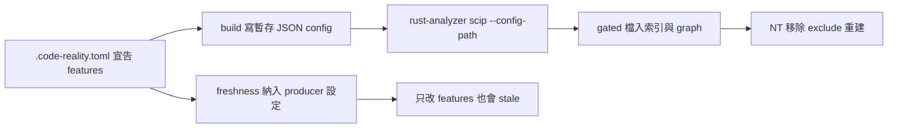

## Description

<!-- SECTION:DESCRIPTION:BEGIN -->
接續 cr-14 POC：把 cargo features 支援接進 rust producer——repo 的 .code-reality.toml 可宣告要啟用的 features，build 以 scip --config-path 傳給 rust-analyzer，feature-gated 檔納入索引與 graph（NT 移除 205 檔 exclude 重建）。關鍵契約：只改 features 設定也必須讓 freshness 變 stale（禁 false-fresh），索引 stamp/manifest/graph 與生效的 producer 設定一致；未設定的 repo 行為完全不變。

<!-- SECTION:DESCRIPTION:END -->

## Acceptance Criteria
<!-- AC:BEGIN -->
- [ ] #1 NT 1.99.0 --config-path 啟用指定 feature：SCIP 含 gated 定義、baseline 不含
- [ ] #2 未設定 features 的 repo：producer 行為與 coverage 結果完全不變
- [ ] #3 單一與多 workspace 的 feature selection 正確（per-root 映射）
- [ ] #4 無效 feature／Cargo 失敗／config 解析異常均 fail loud
- [ ] #5 只改 feature selection（source 不變）freshness 不 false-fresh
- [ ] #6 index stamp／manifest／graph 與生效 producer 設定一致
- [ ] #7 NT 移除可恢復 exclusions 後 coverage gate 通過，剩餘 exclusions 有明確理由
- [ ] #8 不引入 DEF collisions／重複文件／跨配置靜默覆寫
<!-- AC:END -->

## Implementation Plan

<!-- SECTION:PLAN:BEGIN -->
〔baseline：code-reality 6e2dcde〕規模＝standalone EP（full tier），前置＝cr-14 POC 成立；codex 設計討論全文＝job-mvc9qrg8（含 AC 草樣 F1-F9）。
〔已決策勿重辯：①方案 (c) scip --config-path 優先（以 cr-14 POC 結論為準）；②shadow worktree＝最後備援、"all" 不作預設（互斥 feature／平台專屬／native deps 風險）；③profile 設定 opt-in（候選 schema [rust] features，未設定＝現行 default-features 行為完全不變）；④多 Cargo workspace 須支援 per-root features 映射（feature 名與相依各 root 不同，沿用 DB-100 root composition 面）；⑤fail loud：未知 feature、非法組合、config 解析異常、Cargo 失敗均不可靜默忽略（上游 config 套用錯誤只走 logging——須驗產物非只看 exit 0）；⑥freshness 契約：producer feature selection 必須納入可驗證 freshness contract（identity 演算法升級或與 index/manifest 綁定的 producer-options fingerprint，優先 additive 相容設計）——只改 features 而 source 不變時禁 false-fresh（現行 identity.rs:34-48／engine.rs:749-760 未涵蓋 feature selection）；⑦index stamp／manifest／graph 與生效 producer 設定一致，不能只在 build report 印 features；⑧落地後 NT 移除可恢復 exclude 重建，coverage gate（ROOT-08/09）須過，剩餘 exclude 有明確理由〕
範圍：build/stage_rust 接線＋profile 欄位＋identity/freshness＋多 root 映射；不含 JS/TS/Python 面；上游 scip panic #21269 已由 #21270 修復非阻塞（NT 1.99.0 上驗證即可）。
<!-- SECTION:PLAN:END -->
