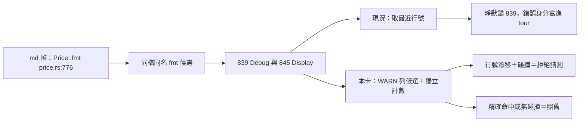

## Description

<!-- SECTION:DESCRIPTION:BEGIN -->
nautilus_trader 回報：tour 裡寫 `Price::fmt() price.rs:776`（語意是 Display 格式化），重產時被錨到 839 行的 `impl Debug for Price` 而非 845 行的 `impl Display for Price`——同檔兩個同名 `fmt`，工具挑了行號近的那個、一句警示都沒有；validate 也抓不到（兩處 pattern 都命中）。

**做什麼**
- 有行號的錨在「同檔＋同名＋同型別、多個 trait 實作」候選時：WARN 列出全部候選（如 [Debug]fmt 839 / [Display]fmt 845），重產報告加獨立計數
- 行號已漂移（非精確命中）且遇上述碰撞：不再猜最近行號——該幀拒絕錨定（fail-closed）
- 行號精確命中或沒有 trait 碰撞：維持現行行為

**不做什麼**
- 不做 `Price::fmt[Display]` 消歧語法（獨立下一卡）
- 不動 graph.db schema、Rust producer、CR-9 的 R1/R2/R3 語義

<!-- SECTION:DESCRIPTION:END -->

## Acceptance Criteria
<!-- AC:BEGIN -->
- [ ] #1 AC-1 NT 原始重現：fixture Price::fmt() price.rs:776＋graph 兩節點（839 impl#[Price][Debug]fmt / 845 impl#[Price][Display]fmt）→ 不得無警示輸出 line=839/symbol=Debug/graph=moved；歧義須揭露且依安全策略拒絕無證據的 nearest 選取
- [ ] #2 AC-2 明確座標仍可解析：Price::fmt() price.rs:845 → line=845、symbol=impl#[Price][Display]fmt().；同時保留 trait collision 資訊供人工辨識
- [ ] #3 AC-3 line-less R1/R2/R3 不回歸：既有 s5_chain_tour.rs 語義保留（雙候選 ambiguous＋候選清單＋不產生錯誤 step）
- [ ] #4 AC-4 一般 moved anchor 不受影響：不同名或無 trait 碰撞的行號漂移維持最近行號選取；既有 nearest tie-break 測試行為保留
- [ ] #5 AC-5 報告一致：CLI 報告與 scenario description 的候選清單、explicit_trait_ambiguous 計數一致；L4 以 NT 真實 graph.db（唯讀）驗證原始錨 776 → 警示/拒絕、修正錨 845 → Display
<!-- AC:END -->

## Implementation Plan

<!-- SECTION:PLAN:BEGIN -->
〔baseline：code-reality 2f76918（v0.16.0）〕

〔已決策勿重辯：
①根因（codex 確認腿 job-mvdsprge-dprgzj 與主 session 自查雙源一致）＝ explicit-line 路徑 GraphAnchor::anchor（chain_tour.rs）的 SQL `WHERE name=? ORDER BY ABS(line_start-文檔錨行) LIMIT 1` 同名多候選靜默取最近；NT 實例＝原錨 776，|839−776|=63 < |845−776|=69 → 必選 Debug。CR-9 的 fail-closed（resolve_candidates）只守 line-less fill 分支，anchor 分支不在守備範圍；R2 的 descriptor_chain 對兩個 impl 都產 ["Price","fmt"]（Trait 段忽略），即使進 R2 也無法消歧。
②安全選取策略：行號精確命中唯一候選 → 保留該錨＋揭露碰撞資訊；行號漂移（非精確命中）＋同型別同名多 trait 候選 → fail-closed 拒絕 nearest 猜測；無 trait 碰撞 → 維持現行 moved 行為。
③獨立計數 explicit_trait_ambiguous（scenario description 與 CLI 報告），不混入既有 g_counts["ambiguous"]（語義不同：後者＝line-less 無法填入）。
④NT 案 2（Price::fmt[Display] qualifier 語法）＝下一張獨立卡——須處理 SCIP descriptor grammar（含泛型 trait 如 Add<Self>），不與本卡耦合；NT 案 3（description 自由文字 lint）不做——無法機械驗收。
⑤修改範圍＝chain_tour.rs／symbol_resolve.rs（共用候選查詢與 Rust impl descriptor 辨識）／tests/s5_chain_tour.rs／plugin/skills/code-reality-tools/SKILL.md；明確不動：graph.db schema、Rust SCIP producer、R1 pseudo-constructor pairing、既有 R2 dotted-scope 對齊語義、tour_validate 自由文字推斷、MCP 新工具或 CLI 新旗標。〕

範圍：上述四檔。descriptor_chain 既有語義（保留第一個 [Type]、忽略其餘 Trait bracket）不改——碰撞辨識走新的 descriptor 判讀，不動 R2。
<!-- SECTION:PLAN:END -->

## Implementation Notes

<!-- SECTION:NOTES:BEGIN -->
〔checkpoint 2026-10-18 21:00〕deep-work 接手。進度：實作✅（4檔+730/-20，全量769綠，L4 NT真corpus雙場景PASS）→雙審✅（fresh-eyes F1 block八項＋codex C1/C2，帳本 .review/main.md canonical PASS）→GLM-5.3 judge in flight（job-mvduzfrk-yuc0l5）。剩：judge裁決→修正迴圈(F1 bracket跳脫為block必修)→docs鏈(SKILL.md+Capabilities)→收尾receipt→commit(AUTH鏈式)→release v0.17.0→回信NT(AUTH「修好要回信」)→結案。23:45 /at 檢查點已授權（沒做完接續做）

〔judge verdict 2026-10-18 21:40 GLM-5.3 job-mvduzfrk-yuc0l5〕✅10/❌1/⚠️0——F1 block：trait_cands_inline bracket→全形［］（三面單點）＋往返測試；C1：fail-closed graph-read-error（棄 Result 化）＋BLOB 回歸；C2 省略計數＋SKILL 對齊；F2/F3 補測試；F4/F5/F6 措辭（F6 行為變更歸 qualifier 卡）；F7 記下一卡；F8 ❌（check_links 不掃 tour-level desc，否證成立）；F9 kind 尾綴。Apply 批次 A(renderer)/B(fail-closed)/C(測試)/D(文檔)。全程 jsonl：.delegate-bridge/jobs/job-mvduzfrk-yuc0l5.jsonl

〔review ledger converged 2026-10-18 23:59〕[main.md] findings=11 tables=1 decisions ✅=10/❌=1/⚠️=0/unknown=0 (source=決策) status resolved=0/verified=10/closed=1/open=0/unknown=0 未決=0 unparsed=0 ……full=ok——✅10 verified（F1 NT L4 端到端 fails=0 重驗）／❌1 closed（F8）／0 open；legs 三腿 n/a（碼讀審查無 CR 結構查詢）；帳本 .review/main.md converged canonical PASS
<!-- SECTION:NOTES:END -->
