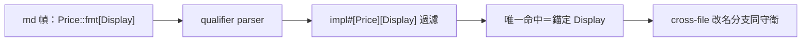
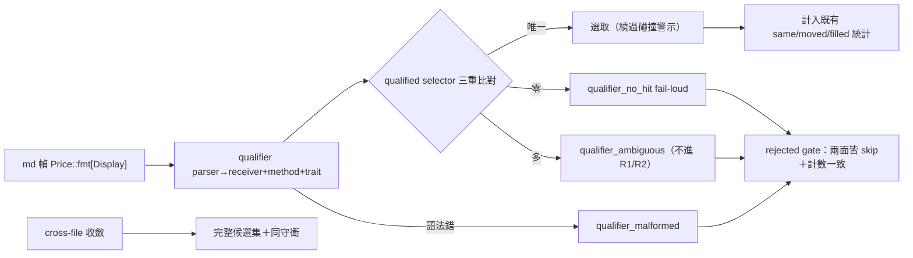

## Description

<!-- SECTION:DESCRIPTION:BEGIN -->
nautilus_trader 建議案 2（codex 確認腿 job-mvdsprge-dprgzj 建議獨立卡）：md 幀符號支援 `Price::fmt[Display]` 形——作者明確指定 trait，resolver 以 qualifier 過濾候選，不再靠行號鄰近或 WARN 人工判讀。前提：SCIP descriptor grammar（含泛型 trait 如 `` `Add<Self>` ``、巢狀 bracket 截斷議題）需完整處理，非簡單 regex。

**同時承接**（CR-17 審查 F7，judge 裁歸本卡）：cross-file moved-file 分支同 hazard——文檔路徑改名後收斂至單檔，現行 `ORDER BY line_start, symbol LIMIT 1` 取最低行且寫 g_symbol，同名 trait impl 碰撞無警示。

**不做什麼**：CR-17 已落地的同檔 explicit-line 碰撞警示與安全選取不重做。

<!-- SECTION:DESCRIPTION:END -->

## Acceptance Criteria
<!-- AC:BEGIN -->
- [ ] #1 AC-1 語法兩形＋path 包裝形解析正確（QualifiedMethod 三元組）；剝離後 symbol/ident 行為釘住（不經 best_ident 陷阱）
- [ ] #2 AC-2 四態語義：唯一命中選取（無碰撞警示）；零命中 fail-loud；多命中 ambiguous 不進 R1/R2；語法錯 malformed——全部拒絕態在 build_tours skip（含 explicit-line），skip reasons/g_counts/CLI WARN 一致
- [ ] #3 AC-3 三重身分比對：異型別同 trait 候選不被誤選（fixture：impl#[Price][Display]+impl#[Other][Display]）
- [ ] #4 AC-4 cross-file：單檔收斂後完整候選集＋碰撞判定，唯一才寫 g_symbol；讀取錯誤顯式退化（不當完整集）；rels>1 維持 moved-file-ambiguous
- [ ] #5 AC-5 F6 三態：malformed impl sibling（可能同 receiver/method）阻止唯一命中——無 qualifier 與有 qualifier 路徑都適用；巢狀泛型 bracket-depth 解析（AsRef<[u8]> 測試）
- [ ] #6 AC-6 tour_reanchor bootstrap 對 qualifier title 用同 parser 或拒絕回填；tour_validate 輸出契約（全形 bracket）遵守
- [ ] #7 AC-7 既有零回歸：CR-17 全測試（含泛型 collision）、R1/R2/R3、line-less 無 qualifier 路徑 byte-identical；L4 NT 真實 graph.db：Price::fmt[Display] 錨 776（漂移）→ qualifier 唯一命中 Display 正確錨定（不再拒絕）
<!-- AC:END -->

## Implementation Plan

<!-- SECTION:PLAN:BEGIN -->
〔baseline：code-reality 7e4cb71（v0.17.0＋CR-17 落地後 main）〕

〔已決策勿重辯：
①來源鏈＝NT 案2＋CR-17 審查 F7/F6＋codex 設計討論腿 job-mve9wzsm-cucmfe（2026-10-19，「A1 三落點架構保留＋四規格修訂」）＋主 session illustrate 結構判讀＋POC 讀碼證據。
②**核心不變式（最高優先）**：一旦作者提供 qualifier，任何無法證實該宣告式身分的情況，都不得以行號、名稱相似度或 R1/R2 重新選出另一個 symbol。
③語法：`Price::fmt[Display]` 正典＋`Price::fmt()[Display]` 相容＋path 括號包裝 `(pkg/price.rs:845)` 形支援——語法解析與 path extraction 順序列測試。
④qualifier parser 直接產 `QualifiedMethod{receiver, method, trait_name}`——**不走 best_ident**（POC 實證二次陷阱：剝離後 `Price::fmt` 無括號時 best_ident 長度擇優選 Price(5)>fmt(3)；原場景 Display(7) 勝——兩層都錨）；Frame.symbol 保留作者原文（CodeTour title 保留消歧意圖），查詢身分另存。
⑤共用 qualified selector：method（SQL name=?）＋receiver＋trait 三重比對（impl_trait_groups 的型別+trait 簽名群）——只比 trait 會錯選異型別同 trait；四態：0→qualifier_no_hit（fail-loud 不退 nearest）、1→選取（繞過碰撞語義——宣告式身分）、>1→qualifier_ambiguous（**不進 R1/R2 消解**）、語法錯→qualifier_malformed；qualifier 缺席→既有 CR-17/R1/R2/R3 語義不動。
⑥F6 收口三態：ValidImpl／MalformedImpl／NonImpl——malformed impl candidate 可能同 receiver/method 時阻止未證實的唯一命中（保守向），qualifier 路徑同樣適用。
⑦cross-file（F7）：rels.len()==1 單檔收斂後**取完整候選集**（讀取完整性——filter_map flatten 吞錯是 CR-17 C1 同型課）→ qualifier/碰撞判定 → 唯一確認才寫 g_symbol；rels>1 維持既有 moved-file-ambiguous（qualifier 不擅自跨檔選取）。
⑧grammar 兩責任分離：SCIP impl descriptor parser 與 md qualifier parser 共用 bracket scanner（depth tracking——修巢狀 `AsRef<[u8]>` 於第一個 ] 截斷）；**不動 descriptor_chain 的 R2 歷史行為**；CR-17 泛型 collision 測試維持通過＋新增巢狀測試。
⑨rejected outcome gate（codex 點名必要 AC）：qualifier_no_hit/ambiguous/malformed 在 build_tours 正確 skip（explicit-line 帶行號也不得落到 step_of）——g_counts、scenario skip reasons、CLI WARN 狀態分類一致；成功選取計入既有 same/moved/filled/moved-file（統計可比性），qualifier 成功率可另計。
⑩計數鍵：qualifier_no_hit／qualifier_ambiguous／qualifier_malformed／qualifier_unverified／cross_file_trait_ambiguous（moved-file 單檔未消歧碰撞）；explicit_trait_ambiguous 保留 CR-17 語義。
⑪消費端：tour_reanchor bootstrap（tour_reanchor.rs:114 best_ident_filtered）對含 qualifier 的 step title 必須用同 parser 或明確拒絕回填——不得讓維護工具重新引入 CR-18 已消除的錯誤；tour_validate 輸出契約（候選顯示全形 bracket）新 WARN/hint 同樣遵守。〕

範圍：chain_tour.rs（frame 剝離/共用 selector/cross-file 守衛/rejected gate）、symbol_resolve.rs（QualifiedMethod parser/三態判定/bracket scanner）、tour_reanchor.rs（bootstrap 防護）、tests/s5_chain_tour.rs（TDD：先釘現況 parse 行為 RED）、plugin/skills/code-reality-tools/SKILL.md（qualifier 語法節）。不動：graph.db schema、producer、R1/R2/R3 與 descriptor_chain 語義。
<!-- SECTION:PLAN:END -->

## Implementation Notes

<!-- SECTION:NOTES:BEGIN -->
〔checkpoint 2026-10-19 01:30〕實作✅（WT cr-18：6檔+1690/-83；91+34 測試綠；全量798綠；L4 NT qualifier面漂移776→Display@845唯一命中正確錨定＋無qualifier對照組維持CR-17拒絕）→雙審✅（codex job-mvebra33：C1高/C2中；fresh-eyes agent_f7b6daa6：F-1~F-8無🔴；帳本WT .review/cr-18.md canonical）→GLM-5.3 judge in flight。剩：judge裁決→修正→post-build收尾→**commit gate PENDING（user本次授權到實作）**

〔judge verdict 2026-10-19 GLM-5.3 job-mvec8vvr〕✅8/⚠️1/❌1——C1/F-1 裁 codex 變體（qm 閘門限縮+rels==0 終端 no_hit）；C2 WellFormed 解除 <4 長度閘；F-2 line-less cands 接線；F-3 拆半（內容形收緊+census）；F-4/F-5 SKILL；F-6 註解；F-7 四測試；F-8 ❌。批次 1→4。verdict 全文：主樹 .agent-tmp/cr18-judge-verdict.md

〔review ledger converged 2026-10-19 02:0x〕✅8 verified（C1/F-1 閘門限縮+rels==0 no_hit、C2 短名跨檔 bypass、F-2 cands 接線、F-4/F-5/F-6 文檔註解、F-7 四測試）／⚠️1 F-3 拆半收案（letterless 收緊+census 零命中→SKILL 披露）／❌1 F-8 否證。全量 806 綠/clippy 逐target等值/qm=None byte-identical。帳本 WT .review/cr-18.md converged canonical。**commit gate PENDING**——user 本次授權到實作（「codex 討論後ＯＫ就來實做吧」）
<!-- SECTION:NOTES:END -->

## Final Summary

<!-- SECTION:FINAL_SUMMARY:BEGIN -->
✅ v0.18.0 已發行（PyPI 三 dist live、tag pushed、marketplace 切片、CC plugin 已更）。trait qualifier 語法 `Price::fmt[Display]` 落地——結構化 {receiver, method, trait} 身分（不走 best_ident——POC 實證雙層陷阱），核心不變式「qualifier 在場時無法證實宣告式身分即拒選（不行號/名稱相似度/R1/R2）」貫穿四路徑（explicit-line/line-less/cross-file/rejected gate）。codex 設計討論腿四規格修訂全吸收（job-mve9wzsm）；實作腿自編排雙審→GLM-5.3 judge（✅8/⚠️1拆半/❌1）→修正四批→followup 全 verified（806 綠、clippy 逐 target 等值、L4 NT：漂移 776→Display@845 唯一命中正確錨定、無 qualifier 對照組維持 CR-17 拒絕）。F6 三態收口（malformed sibling 阻止未證實唯一命中）；cross-file 分支 F7 hazard 設防（完整候選集＋cross_file_trait_ambiguous）；tour_reanchor bootstrap 同 parser 防護。NT 案 2 全兌現，案 3 的結構化 validate 基礎（宣告式身分）就位。

<!-- SECTION:FINAL_SUMMARY:END -->
