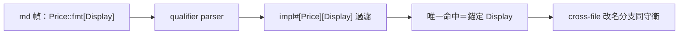

## Description

<!-- SECTION:DESCRIPTION:BEGIN -->
nautilus_trader 建議案 2（codex 確認腿 job-mvdsprge-dprgzj 建議獨立卡）：md 幀符號支援 `Price::fmt[Display]` 形——作者明確指定 trait，resolver 以 qualifier 過濾候選，不再靠行號鄰近或 WARN 人工判讀。前提：SCIP descriptor grammar（含泛型 trait 如 `` `Add<Self>` ``、巢狀 bracket 截斷議題）需完整處理，非簡單 regex。

**同時承接**（CR-17 審查 F7，judge 裁歸本卡）：cross-file moved-file 分支同 hazard——文檔路徑改名後收斂至單檔，現行 `ORDER BY line_start, symbol LIMIT 1` 取最低行且寫 g_symbol，同名 trait impl 碰撞無警示。

**不做什麼**：CR-17 已落地的同檔 explicit-line 碰撞警示與安全選取不重做。

<!-- SECTION:DESCRIPTION:END -->

## Implementation Plan

<!-- SECTION:PLAN:BEGIN -->
〔baseline：code-reality 2f76918（v0.16.0）＋CR-17 修正後樹〕

〔已決策勿重辯：①來源＝NT work-order nt-chain-tour-fmt-ambiguity-20261018 建議案 2；codex 確認腿裁定獨立卡（須處理 SCIP descriptor grammar 含泛型，不與 CR-17 耦合）；GLM-5.3 judge job-mvduzfrk 確認歸屬。②消歧規則（codex 建議）：qualifier 唯一命中→選取；無命中→明確失敗；多命中→ambiguous；qualifier 在場時禁退回 nearest-line。③適用 line-less 與 explicit-line 兩路徑。④F7（CR-17 審查）：cross-file moved-file 分支（chain_tour.rs:574-594）LIMIT 1 取最低行＋寫 g_symbol 無碰撞檢查——本卡一併涵蓋。⑤F6 行為變更（malformed impl-shaped row 保守納入碰撞）歸本卡 grammar parser。〕
<!-- SECTION:PLAN:END -->
