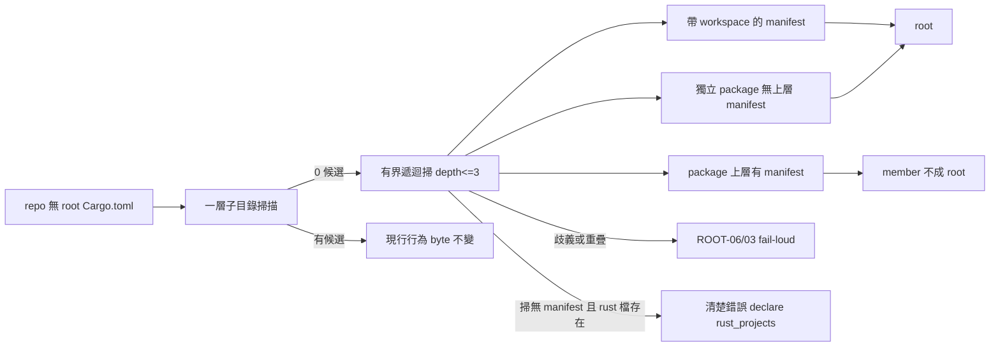

## Description

<!-- SECTION:DESCRIPTION:BEGIN -->
消費者 repo（mosaic_alpha）把 Rust crates 放在 crates/<name>/（cargo 官方慣例、root 無 Cargo.toml）時，`code-reality build` 找不到任何 Rust workspace root，錯把 repo 根目錄餵給 rust-analyzer，得到難以理解的 "no projects" 錯誤（exit 2）。

**做什麼**
- 自動偵測升級：一層子目錄掃描 0 候選時，做有界遞迴掃（深度 ≤3；跳過 dot-dirs/target/node_modules；profile exclude 約束發現範圍），用純 TOML 分類：帶 [workspace]＝root；上層有 manifest 的 [package]＝member；獨立 [package]＝root 候選；歧義/重疊 fail-loud（沿用 CR-RUST-ROOT-06/03）
- 錯誤自診斷：真的找不到 root 但 rust 語料存在時，直接報「rust 語料存在（N 檔）但無可解析 workspace root——declare rust_projects」，不再甩 opaque stack trace

**不做什麼**
- `--producer` 多腿 explicit（codex 同意 defer 另卡）
- mosaic_alpha 自己的 .code-reality.toml 配置（對方自己的卡）

**現在如何**：codex 設計討論已完成（job-mvmjk64o），分類規則修正後凍結進 Plan。

<!-- SECTION:DESCRIPTION:END -->

## Implementation Plan

<!-- SECTION:PLAN:BEGIN -->
〔baseline：code-reality 7560c55（v0.18.0）〕

〔已決策勿重辯——codex 設計討論 job-mvmjk64o 裁決收編＋本地 oracle 補驗〕
① 觸發條件：root 無 Cargo.toml 且 immediate-child 掃描 0 候選才遞迴（depth-1 有候選行為 byte 不變——有意相容策略，深層死路由 ROOT-09 remediation 導向 rust_projects 配置）。
② 分類規則（純 TOML，structural 面零 cargo spawn——frozen Q8 不變；cargo metadata 權威判定照舊在 build staging）：帶 [workspace]＝root；上層鏈有 manifest 的 [package]＝member 不成 root；無上層 manifest 的獨立 [package]＝root 候選（本地 oracle 實證：mosaic 6 roots 中 mosaic-strategy-kc 與 apps/shell_tauri/src-tauri 無 [workspace]——嚴格 06 會卡死真實消費者）；ownership 歧義→CR-RUST-ROOT-06；ancestor/descendant root 重疊→CR-RUST-ROOT-03。
③ 掃描界：depth cap 3（crates/<n>/=2、apps/<x>/src-tauri=3）；skip dot-dirs/target/node_modules（沿用 engine.rs 既有目錄排除規則）；profile exclude 約束 discovery（excluded 目錄下 manifest 不為候選——poc/ 由 profile 面處理，不加全域 vendor 硬編碼）；候選 manifest 讀取失敗 skip、invalid TOML→04 fail-loud（沿 depth-1 語義；掃描失敗不得靜默當零候選）。
④ scan_unlisted_workspaces（07 config-mode 庫存閘，rust_projects.rs:203-240）同布深層掃——深層未列 [workspace]＝coverage hole 07 fail-loud（與 auto 面發現範圍對齊）。
⑤ A guard：governed-empty skip 之後、rust-analyzer spawn 前；條件＝auto 解析空 roots＋governed rust 非空＋repo root 無 Cargo.toml；訊息含 rust 檔數＋原因＋.code-reality.toml rust_projects 修法；BuildError::Env exit 2；governed 空＝維持 SkippedByProfile（Q6 空 roots 契約不變）。同步修正 rust_projects.rs/build.rs 中「no manifest anywhere」類過時註解。
⑥ freshness 面：resolve_structural 僅 rust-bearing repo 觸發（engine.rs:733）——純 python repo 不受影響；~40ms 穩態預算須實測（不得宣稱）；query/freshness/build 三面 root set 排序一致、rust_topology 與 identity v2 同步（深層 root 增刪改須正確翻 stale）。
⑦ C（--producer 多腿）defer 另卡——codex 同意。

〔範圍〕
- rust_projects.rs：auto_discover 遞迴分支＋分類＋07 深層化；build.rs：A guard＋註解修正；engine.rs 拓撤標記互動確認。
- 測試（tests/rust_projects.rs contract＋gate 面）：兩層發現／獨立 package root／member 排除／深層混合／profile-excluded manifest／重疊 03／歧義 06／invalid TOML 04／skip 清單／depth-cap 邊界／depth-1 行為不變／governed-empty skip／A guard 訊息面／identity v2 深層 root drift。
- 文檔：plugin/skills/code-reality-tools/SKILL.md 發現規則與 remediation 同步。
- 驗收：fixture e2e（完整 staging＋publication＋freshness verdict＋coverage）；mosaic_alpha 實樹 dogfood 留給對方升級後跑（跨 repo 主權——我方不動其 .code-reality）。
<!-- SECTION:PLAN:END -->
