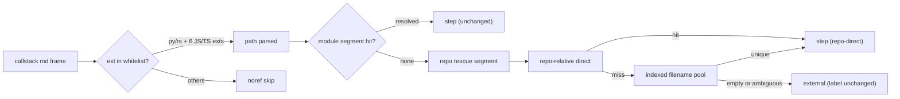

## Description

<!-- SECTION:DESCRIPTION:BEGIN -->
mosaic 來信（mos-565）說 chain_tour 三條路徑 regex「只認 .py」、rust 幀全判 external——查證後歸因要更正：`.rs` 從第一版就在白名單（chain_tour.rs:26/31/36＝`(?:py|rs)`）。rust 幀真正死因是路徑解析掃描根只涵蓋 profile module（mosaic 唯一 module＝`python/mosaic_alpha/`），repo 其他角落（`crates/`、`web/`）的檔案 direct 與 glob 都打不到 → 誤標 external（chain_tour.rs:1450）。同時 DRAFT-68 說的 TS 副檔名缺口是真的：regex 不認 `.ts/.tsx/.js/.jsx/.mjs/.cjs`，TS 幀路徑解析不出 → noref。兩個缺口綁一起修——mosaic 的 TS 幀路徑也在 module 外，只修 regex 會讓 TS 幀從 noref 變 external。

**做什麼**
- 幀文法：副檔名白名單由 language.rs `JS_TS_EXTS`＋py/rs 動態組裝（長副檔名先行），三條 regex 共用單一 helper
- 路徑救援：module 檔行為位元級不變；模組外幀加 repo 段救援（repo-relative direct 優先→索引化 filename pool，不裸 glob、不借 walk_sources）
- 觀察面：repo 段獨立 kind 字串（如 `repo-direct`）＋g_counts 另計一行——救援數可量測

**不做什麼**
- rust Type 節點進 graph（67 族 struct 幀的第二層根因——另卡 CR-21）
- 「external」標籤改名、bash/.sh 副檔名、`@/` alias 路徑文法

**現在如何**：雙顧問設計討論收斂（muse wonder-full job-mvtkvmsn＋codex astra job-mvtkvmvy，2026-10-29），決策凍結進 Plan；target 0.20.0。

<!-- SECTION:DESCRIPTION:END -->

## Acceptance Criteria
<!-- AC:BEGIN -->
- [ ] #1 - [ ] AC1: 幀文法表測——8 副檔名（py/rs/js/jsx/mjs/cjs/ts/tsx）×（explicit path:line／line-less／stray）全綠；每副檔名附 LanguageFace::from_path 非 None 交叉斷言（cargo test s5_chain_tour exit 0）
- [ ] AC2: `see foo.tsx bar.py` 形 remainder 判 stray→noref（行為釘死）；tsx/jsx 長副檔名先行由測試覆蓋
- [ ] AC3: resolver 四階段——module-exact 行為不變；repo-relative exact direct 收編（crates/ 全路徑幀直達）；basename 誤搶反例（module 內同名 lib.rs 存在時 repo-relative 幀解析到 repo 檔）；module 段 ambiguous 不進 repo 段
- [ ] AC4: repo 段 pool 不含 node_modules 誘餌與 excluded 檔；fill_anchor 前路徑 canonical 化（symlink/./ 段案例測試或明列殘餘）
- [ ] AC5: 既有 corpus（本 repo fixtures＋chain_tour_skip_gate）幀級 diff 單向——step 只增不減、x-codeReality.symbol 零改指（改指逐筆解釋）
- [ ] AC6: mosaic kchart-web-overlays.md 唯讀試產：TS 幀 filled>0、≥4 場景存活、external 相對 baseline 下降（實數記 notes）
- [ ] AC7: repo 段救援量可量測（kind repo-direct/repo-suffix 計數呈現於 run 輸出）
- [ ] AC8: cargo test 全量 exit 0；cargo fmt 觸碰面淨；clippy 無新 warning
<!-- AC:END -->

## Implementation Plan

<!-- SECTION:PLAN:BEGIN -->
〔baseline：code-reality b1b3e1c（v0.19.0；安裝 binary 0.19.0+a7b3efa 內容一致）〕

〔已決策勿重辯——雙顧問設計討論凍結 2026-10-29（muse wonder-full job-mvtkvmsn＋codex astra job-mvtkvmvy；全文 .agent-tmp/cr20-consult-{muse,codex}-answer.md）；mosaic 來信＝mos-565 信件 envelope mosaic-alpha-552-rust-anchor-20261029＋patch 提案 ai-analysis/_inbox/ts-anchor-patch-proposal.md〕

① 來信歸因更正（回信必須帶）：三條 regex（chain_tour.rs:26/31/36）＝`(?:py|rs)` 自首版 38c7619 就在——「regex 只認 .py」是誤判。rust 幀判 external 真因＝PathResolver pkg_roots 只含 profile module prefix（mosaic 唯一 `[[module]]`＝python/mosaic_alpha/），`crates/`、`web/` 的檔案 direct＋glob 都打不到 → `(None,"none")` → external（chain_tour.rs:1450-1455）。DRAFT-68（TS 副檔名）缺口為真但只是三缺口之一；TS 幀路徑也在 module 外——A 與 B 是同一交付。

② Leg A 幀文法：副檔名 alternation 由 language.rs `JS_TS_EXTS`（js/jsx/mjs/cjs/ts/tsx）＋py/rs 動態組裝，三條 regex 共用單一 helper（OnceLock 內 format!）。**長副檔名先行**（tsx 在 ts 前、jsx 在 js 前）——any_path_re 無後置錨，短先行會讓 `foo.tsx` 命中 `foo.ts`、stray_path_token 見尾 `x` 判非 stray（兩家顧問同抓）。語言層只提供副檔名資料，不承擔 frame 文法；py/rs 在組裝端仍是字面量（JS_TS_EXTS 不含它們）。**誤報面誠實條款**：explicit `ref_re` 本就無 token 邊界檢查（URL/query 中的 `foo.ts:12` 舊風險擴及新副檔名——明列殘餘限制，不宣稱已防護）；`stray_path_token` 變嚴會讓少數既有 prose 幀退步（fail-closed 方向正確）——列入 corpus diff 檢視項。

③ Leg B 解析序（四階段）：module-exact direct（現行，不動）→ **repo-relative exact direct（新）** → module heuristic（suffix/basename/ctx，現行）→ repo 段 filename pool（僅 module 段 `(None,"none")` 時）。語義變更明文化：repo-relative exact 優先於 module heuristic（修 basename 誤搶反例：幀寫 `crates/x/lib.rs` 而 module 內另有 `lib.rs` 時，現行 basename fallback 會錯抓 module 檔、永遠到不了正確檔）；module 段 ambiguous 終局不進 repo 段（fail-closed，雙義參照不猜）。

④ repo 段實作形：**禁裸 `glob("**/{fname}")` 打 repo_root**（node_modules/.pnpm 萬級目錄＝分鐘級成本＋誘餌入 pool）——延遲建 repo 索引：首次需要 repo 段時單趟遞迴；skip dot-dirs＋既有 SKIP_DIRS 常數＋`target`（常數借用 engine.rs 既有清單，禁第二份）；只收 `LanguageFace::from_path` 非 None 的檔（pool＝graph 可錨集自動一致）；`is_excluded` 在 repo 段（direct＋pool）一律查（corpus 救援語義；module direct 的既有不對稱凍結不動）；以 fname 為 key memoize；**禁呼叫 walk_sources**（rust_projects 耦合——會讓 rust 設定誤炸 python tour 產生面）；路徑 canonical 化比照 graph_db 的 `resolve`（防 symlink/`./` 段讓 fill_anchor 的 exact path 對不上 graph 存量而安靜 not-in-graph）。

⑤ 觀察面：repo 段獨立 kind 字串（`repo-direct`/`repo-suffix`）——救援數可量測；repo 段 tie 需唯一勝出（平手→ambiguous fail-closed）；module 段平手行為凍結。repo 段命中同樣 bump_dir（上下文連續性）。

⑥ 「external」標籤本卡不改名（skip_gate 測試斷言 `external 1`＋shell WARN 字串＋歷史 .tour description 是凍結面）；skip_reasons 軸（external）與 g 分佈軸（noref）的既存矛盾（chain_tour.rs:1632 分流）僅註記不修——改名（如 missing-file）另案。

⑦ 版號 0.20.0（minor——resolver 語義變更＝consumer .tour 產出實質變更；CR-19 先例 fix-request 走 minor）。release note 明寫：裝 binary 即生效、**不需 rebuild graph**。bash/.sh（來信提及「後續」）不在此卡——LanguageFace 無 Shell 面，屬新語言面另案。

〔範圍〕
- `crates/code-reality/src/chain_tour.rs`：三 regex 動態組裝＋PathResolver 四階段＋repo 索引。language.rs 僅消費（JS_TS_EXTS 定義不動）。
- 測試：s5_chain_tour.rs 文法表測（8 副檔名 × explicit/line-less/stray，**獨立列舉**禁從常數派生＋每副檔名斷言 `LanguageFace::from_path` 非 None＋`see foo.tsx bar.py` stray 釘死）；resolver 級新測（模組優先釘樁：module 內外同檔名共存 module 贏／repo-direct 收編／repo pool 歧義 fail-closed／excluded 不收編／node_modules 誘餌不入 pool／basename 誤搶反例：module 內 lib.rs 存在時 repo-relative 全路徑幀解析到 repo 檔）；chain_tour_skip_gate.rs external 案例不改。
- 文檔：plugin/skills/code-reality-tools/SKILL.md（frame 文法副檔名＋resolver 語義同步）；crates/AGENTS.md 若有 regex 白名單敘述同步。
- 驗收 oracle：mosaic `ai-analysis/blueprint/callstack/kchart-web-overlays.md` 唯讀試產（`--repo` 指向 mosaic main、graph 用其現有 fresh graph、`--out-dir` 落本 repo .agent-tmp）——TS 幀 filled>0 且 ≥4 場景存活（baseline 1/4、filled 5/noref 33）；本 repo 既有 corpus 幀級 diff 單向（step 只增不減、`x-codeReality.symbol` 零改指、改指逐筆解釋）。
- 附帶登記（不修）：engine.rs `is_test_path` 六副檔名硬編碼＝副檔名知識第三副本（backlog draft 已建）。

**Final Summary 預告（Mockup 三件套）**：①終態圖＝desc 圖 as-built 對照；②user-visible surface＝CLI `code-reality chain_tour` 輸出（skip/step 計數與 g 重錨分佈——TS 與 repo 外幀從 skip 變 step；無新 flag 無新介面）；③樣張＝kchart-web-overlays.md 試產 before/after 摘要行（before：filled 5/noref 33/場景 1-4 全 skip；after 實數記卡 notes，trivial surface 以 AC 內 expected output 取代正式樣張）。
<!-- SECTION:PLAN:END -->
