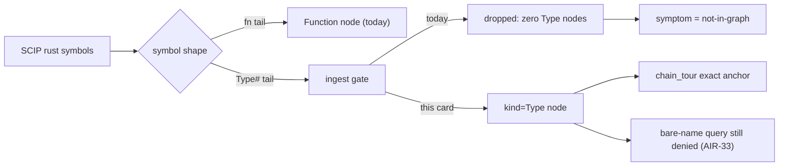

## Description

<!-- SECTION:DESCRIPTION:BEGIN -->
mosaic 67 族的 rust 幀（`MarketDataGlobalGate`、`ShardConnTracker` 等 struct ident）即使 CR-20 修好路徑解析也錨不到：graph 的 rust 節點 1149 顆全部 kind=Function、零 Type——struct 定義符號（`Type#` 形，如 `rust-analyzer cargo sj_backend 0.1.0 request_scheduler/MarketDataGlobalGate#`）在 ingest 端被 `queryable_symbol` 丟棄（engine.rs:99 只放行 python face 或 JS/TS 文檔的 `#`-tailed Type）。這是 AIR-33 裁決「rust Type 不可 bare-name 查」的副作用：同一個 predicate 同時管 ingest 與 query 兩軸。本卡把兩軸分開——rust Type 進 graph 成節點（chain_tour 的 exact path+name 錨定、tour_reanchor、semantic_search 都可用），bare-name 查詢面維持 AIR-33 排除位元級不變。

**做什麼**
- ingest 與 query 分離：predicate 改名（如 `ingest_symbol`）、放行判準比照 JS/TS 的 document authority（`LanguageFace::from_path == Rust`）；`matches_query` 不動
- cache `SCHEMA_VERSION` bump（"4"→"5"）——不改則舊政策 cache 以 fresh 之姿續餵 graph、修正靜默無效且症狀與本缺口相同
- 契約改述（materialization presence vs bare-name queryability 兩軸）＋既有測試 `s3_rust_regression_types_stay_filtered_and_untestable` 拆分（ingest 放行斷言與 bare-query 仍空斷言分離）
- 五項量測 gate：nodes/edges by kind delta、既有 corpus g_counts 單向 diff、hub 前 20 名單過目、cache 體積/occurrences 增量、build wall-clock 前後比

**不做什麼**
- bare-name query 開放 rust Type（AIR-33 續管轄）
- enum variant／多 `#` 形（165/384）預先裁剪——全收，量測後若 hub 前段被 variant 名佔據再收緊為「descriptor 末段恰一 `#`」（旋鈕寫在卡面、量測後裁決）

**現在如何**：與 CR-20 同批顧問收斂定案的姊妹卡；target 0.21.0。生效前提＝consumer 全量 `code-reality build` 重建 graph（只裝 binary 不 rebuild 無效）。

<!-- SECTION:DESCRIPTION:END -->

## Acceptance Criteria
<!-- AC:BEGIN -->
- [ ] #1 - [ ] AC1: rust Type DEF 進 nodes（kind=Type、exact path+name 可錨）；bare-name query（matches_query 兩 sites）行為位元級不變——js_ts_graph.rs 拆分測試雙斷言
- [ ] AC2: cache SCHEMA_VERSION bump 4→5；升級後舊 cache 判 stale 觸發重建（測試釘）
- [ ] AC3: 契約改述四處同步（engine docstring×3＋cache 註解＋crates/AGENTS.md）——materialization presence vs bare-name queryability 兩軸
- [ ] AC4: 量測 gate 五項全跑（nodes/edges delta、corpus g_counts 單向、hub 前 20 過目、cache 增量、build wall-clock）——缺項即未完成
- [ ] AC5: multi-# 形全收（普查實數記 notes）；hub 汙染旋鈕量測後裁決記錄
- [ ] AC6: cargo test 全量 exit 0；fmt/clippy 淨
- [ ] AC7: release note＋回信明寫生效前提（裝 binary＋全量 rebuild）
<!-- AC:END -->

## Implementation Plan

<!-- SECTION:PLAN:BEGIN -->
〔baseline：code-reality b1b3e1c（v0.19.0）〕

〔已決策勿重辯——與 CR-20 同批顧問收斂凍結 2026-10-29（muse job-mvtkvmsn＋codex job-mvtkvmvy）；本卡=CR-20 姊妹卡，67 族 struct 幀 oracle 的第二層根因（F4）〕

① C1 形——ingest/query 雙軸分離：`queryable_symbol` 拆為 ingest eligibility（新 predicate，如 `ingest_symbol`：fn-shaped 恒收＋`#`-tailed 收 python face／JS-TS 文檔／**Rust 文檔**——放行判準比照 JS/TS 的 document authority `LanguageFace::from_path == Rust`，不比照 python symbol prefix）與 bare-name query eligibility（`matches_query` AIR-33 行為位元級不變）。手術面（muse 查證 exact）：ingest gate 生產消費＝cache.rs:83（build_db）＋graph_db.rs:355/382（scan 雙臂）＋graph_db.rs:906（節點插入重查）四 sites——cache 那處不可跳過（graph Sqlite face 吃 cache occurrences 表，cache 不放行 graph 端放行也無米）；query gate＝engine.rs find_deps＋cache.rs sqlite_defs 兩 sites 不動。

② cache `SCHEMA_VERSION` "4"→"5"（cache.rs:26）——stale 判準只有 mtime/schema/head 三項，不 bump 則 consumer 升級後舊政策過濾的 cache 以 fresh 之姿續餵 graph、修正靜默無效且症狀＝not-in-graph（與本缺口 F4 同症狀，會燒一輪跨 repo 往返）；"3"→"4" 註解史證明政策變更 bump 是既有慣例。graph.db 無 builder 政策版強制重建齒——release note＋回信明寫「生效＝裝 binary＋**全量 `code-reality build` 重建**，只裝不建無效」。

③ 契約改述＋測試拆分：engine.rs docstring（queryable_symbol/class_arm_matches/python_face 三處）＋cache.rs:81 註解＋crates/AGENTS.md single-gate 敘述改為兩軸（*materialization presence* vs *bare-name queryability*——AIR-33 續管轄後者）；既有測試 `s3_rust_regression_types_stay_filtered_and_untestable`（js_ts_graph.rs:403）拆分：ingest 放行斷言（rust Type DEF → nodes kind=Type、exact path+name 可錨）與 bare-query 仍空斷言分離。這是 AIR-33 的**窄修正**（精確度來源論證：bare query 的泛濫風險是排除理由，chain_tour fill 是 exact file_path+name、泛濫不存在）不是推翻裁決。

④ 全收不預裁剪：multi-`#` 形（enum variant `Side#Buy#`、pyo3 宏 `Exposure#PyFunction#`——mosaic scip 普查 384 本地 `#` 符號中 165 個）全收（python 嵌套 class 同款收法；工具端自創「單#才算型別」第二語義會在 variant-as-frame 需求再開洞）；量測後若 hub 前 20 被 variant 名佔據或 corpus 出現 filled→ambiguous 回歸 → 收緊「descriptor 末段恰一 `#`」——旋鈕寫卡面、量測後裁決。

⑤ 量測 gate 五項（上線前必備，缺一不宣稱安全；本 repo＋mosaic（唯讀）重建 graph 前後對帳）：(1) nodes/edges by kind delta；(2) 既有 chain corpus g_counts 單向 diff——只允許 noanchor/external→filled，任何 filled→ambiguous 或 step 的 `x-codeReality.symbol` 改指逐筆解釋（explicit-line 同名 fn+Type 最近行選擇 chain_tour.rs:560＝理論非單調點，量級預期近零必實測）；(3) hub 前 20 名單 diff 人工過目；(4) cache 體積/occurrences 增量（std 型別 ref 進 occurrences——未驗證項）；(5) build wall-clock 前後比。

⑥ blast radius 已核銷（muse 實測普查）：nodes 成長有界（rust +~384 上限、全 graph +1%）；flows 不受影響（entry point 只收 Function/Test）；completeness audit 不受影響（db_functions/audit_targets 只認 fn tail）；受影響面＝communities/hub 度數/semantic_search/detect_changes 計量——rust 加入 python Type 既有政體，非新發明政體。正面外溢：tour_reanchor/tour_validate（SymbolLocator exact 查）與 semantic_search 對 struct 名自動可用。

⑦ 版號 0.21.0（獨立 minor）；若與 CR-20 同窗完成可同版合發 0.20.0（切卡是工作組織、release 是交付節奏——但不因湊版寬限量測 gate）。過渡橋（回信明寫）：C 落地前 struct 幀可補 explicit 行號（`…rs:49`）走 CR-20 explicit 面成步（g=not-in-graph 誠實標示、座標用文檔行）——文檔面債務，C 落地後可拆。

〔範圍〕engine.rs／cache.rs／graph_db.rs（predicate 拆分＋schema bump）＋js_ts_graph.rs 測試拆分＋新增 rust Type ingest 測試（含同名 Type/Function 同檔歧義）＋文檔四處同步＋mosaic 端 rebuild 後 67 場景 D struct 幀 filled oracle（對方動作，我方不動其 repo）。
<!-- SECTION:PLAN:END -->
