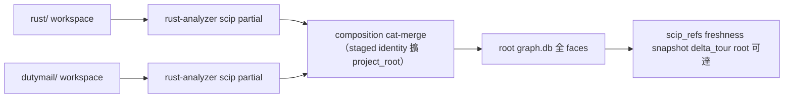

## Description

<!-- SECTION:DESCRIPTION:BEGIN -->
delegate-bridge repo 來信請求（dutymail db100-cr-root-graph-solicit-001＋supplement 補充，寄 code-reality-marshal 門牌——本 repo 首封責任信）：CR 原生支援 multi-Cargo-workspace root graph，SCIP producer 層 composition，各 Cargo workspace 保留不動。

**痛點（來信方實測）**：dual-Cargo-workspace repo（rust/＋dutymail/）下 CR root build exit 2（rust-analyzer reports more than one project）、root graph 對 dutymail 面 stale（10/03 實測 0 dutymail nodes；root index 在 dutymail 落地前一日本是健康三語言 index）、snapshot/delta_tour 因 git-root 錨定不可達——每個結構宣稱都要 per-subworkspace 繞路。

**信中承重事實已在本 repo 逐點驗實（2026-10-09 收信驗證）**：build.rs cat-merge N-way POC-verified；stage_rust 單 repo dir（build.rs:374）；merge_and_publish 每族只取第一 leg——塞兩個 Rust partial 會靜默掉一個（build.rs:447）；StagedLeg identity=(family,path)（build.rs:204）需擴 (family, project_root)；graph_db.rs nodes.symbol UNIQUE＋INSERT OR IGNORE——跨 workspace symbol 碰撞會靜默掉 node（需負向測試）。

**雙腿研究收斂**（codex 腿(e)＝GLM 腿(c)，實體相同）：producer 層 composition。反合併 Cargo workspace：lto=true+panic=abort（crash-only）vs dutymail 無此二者、stable cargo 不能 per-package 覆寫 profile；lock 紀律不對稱（assemble-release rust 腿不帶 --locked、dutymail 腿帶 --locked --offline）；產品邊界從 workspace 隔離退化為僅 lint 保護。反 rust-analyzer linkedProjects：scip CLI 不讀＋root 埋 rust-project.json 會劫持本 repo 所有 RA consumer。

<!-- SECTION:DESCRIPTION:END -->

## Acceptance Criteria
<!-- AC:BEGIN -->
- [ ] #1 - EP TC-1：normalize 後 document paths＝`<project_root_rel>/<old_rel>`（`"."` root 不加前綴）、symbol strings 逐位元組不變、無 `..`/絕對路徑殘留（tests/multi_rust_build.rs）
- [ ] #2 - EP TC-2：合流＝Σ docs；merge_and_publish/StagedLeg 零 diff（rg 斷言）；tests/build.rs 既有測試零改動全綠（zero-roots fallback 承載）
- [ ] #3 - EP TC-3：跨 root DEF collision publication 前 exit 2 含雙方位置、live slot byte-identical；root 內 duplicate-target 不新增拒絕
- [ ] #4 - EP TC-4/5：Cargo-only 變更 freshness exit 1 content-drift 非 fresh；identity v2 content-addressing 同構（TC-1a）＋config 效果面（外觀編輯不假 stale）＋byte-exact spec pin
- [ ] #5 - EP TC-6：v1/legacy/keyless Rust slot → `identity-algo-upgrade` fatal 不得 fresh；auto-heal 重建 restamp v2
- [ ] #6 - EP TC-7（AC1-4）：root graph 含兩 workspace＋JS/TS/py 三 faces；snapshot/delta_tour git HEAD 錨定 root-relative；node count＝Σ queryable DEF sets（跨 root 交集零）
- [ ] #7 - EP TC-8/11：CR-RUST-ROOT-01..08 逐一 exit 2＋文本斷言；兩面 roots 集合一致（freshness 零 cargo metadata spawn）
- [ ] #8 - EP TC-9/10：v1 非 Rust slot 一次性退化揭露（legacy-signals 非 fresh、rebuild 後恢復）；Cargo-present rs-absent 不獲 rust face
- [ ] #9 - `cargo test` workspace 全綠（階段 3 完成閘門）
- [ ] #10 - 真倉 dogfood：delegate-bridge root build exit 0＋freshness v2＋雙 root 符號命中＋對方 boundary test 綠（SM-11）
<!-- AC:END -->

## Implementation Plan

<!-- SECTION:PLAN:BEGIN -->
〔baseline：code-reality 25fd932（v0.9.5）〕

〔已決策勿重辯：①採 SCIP producer 層 composition——codex 腿(e) 與 GLM 腿(c) 雙腿獨立收斂，實體相同（完整報告：delegate-bridge repo 2026-10/10-09-bridge-architecture/references/cr-root-advisory-{codex,glm}-result.md）②不合併 Cargo workspace——release profile 分離（rust lto+panic=abort crash-only vs dutymail 無）、lock 紀律不對稱（assemble-release rust 腿無 --locked、dutymail 腿有）、產品邊界退化；DB-80 O6 凍結（workspace 搬遷需新決策）③不採 rust-analyzer linkedProjects——scip CLI 不讀（--help 實查）、root 埋 rust-project.json 會劫持本 repo 全部 RA consumer④不做 SQLite 縫合（已有 SCIP merge 無須另建）⑤風險面：跨 workspace SCIP symbol 碰撞被 graph_db.rs INSERT OR IGNORE 靜默掉 node——須負向測試斷言 node count；corpus discovery 禁硬編碼目錄名（CR 是通用工具）〕

〔範圍：stage_rust 支撐多 Cargo workspace roots；**merge 粒度＝pre-concat（EP Q3 凍結取代本句原案的 staged-multi-leg：StagedLeg/merge_and_publish 契約零改動，rust family 內部合流——supersession 依據＝EP 凍結邊界 2）**；root freshness 涵蓋 Cargo manifests/locks/project topology（防 Cargo 變更 false-fresh；identity v2）；root snapshot/delta_tour 以 git HEAD 正確錨定；兩 workspace 雙向 no-cross-path-dep gate 完好。驗收條件（來信 AC1-4，EP TC-7 承載）：AC1 root graph 含 rust+dutymail+JS/TS；AC2 freshness 涵蓋 Cargo 面；AC3 snapshot/delta_tour git 錨定正確；AC4 boundary gate 完好＋symbol 碰撞負向測試。開放設計點已由 EP Q1 裁決：Combined（config rust_projects 權威＋保守 auto，歧義 fail-loud）。規模分級：full → standalone EP＝`ai-analysis/2026-10/10-09-db100-multi-root/ep.md`（v2，EP Review 18 findings 回寫完成）〕
<!-- SECTION:PLAN:END -->

## Final Summary

<!-- SECTION:FINAL_SUMMARY:BEGIN -->
multi-Cargo-workspace root graph 落地：rust_projects resolver（structural/authoritative 兩層＋CR-RUST-ROOT-01..08）＋identity sha256-v2（Cargo/topology 進 trust boundary，v1 Rust slot 升級恆 stale）＋per-root composition（normalize→pre-concat→collision gate，StagedLeg 零改動）＋E2E 7 測試。審查鏈：EP boundary×2（18 findings）＋段級×3＋弧級×2＋跨家族 codex web（3P1+1P2）＋GLM-5.3 judge（5 採納含 P3-E）——七波修正腿全落地，全套 46 targets 578 passed 零 warning。真倉 dogfood：delegate-bridge root build exit 0、graph 3787 nodes、freshness v2 fresh、對方 boundary 18/0。v0.10.0 已發佈（三 dist PyPI＋marketplace slice）。
<!-- SECTION:FINAL_SUMMARY:END -->
