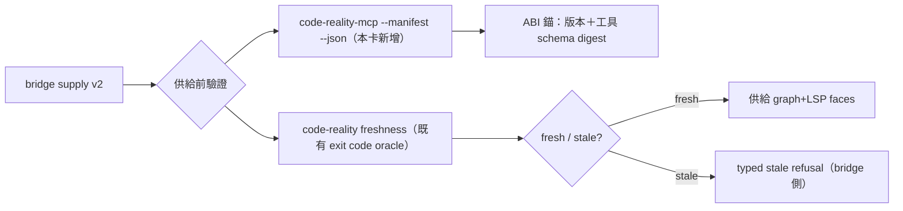

## Description

<!-- SECTION:DESCRIPTION:BEGIN -->
delegate-bridge 來信（dutymail db108-cr-supply-contract-001）：bridge 想把 CR graph+LSP 真正供給給 writer 腿，要 CR 側回答六項契約。六項中四項有現成面（安裝登記／lsp-bridge／freshness／工具清單），兩項缺口由本卡補上：

**做什麼**：(1) 兩個 MCP server 的 initialize 身分面現自查成 rmcp/3.5.1（rmcp crate 的 from_build_env 在 rmcp 內展開）——bridge 無法用 serverInfo 當版本錨；蓋上真名真版。(2) 新增 `--manifest --json` publisher 自宣告面：版本、進入點形態、協議協商、工具清單＋schema digest——bridge 相容性驗證的錨，binary 自帶隨版出貨、免第二 pin。

**不做什麼**：不改 bridge 側（那是對方 repo 的弧）；graph_query per-answer stale 標記本卡不做（組合式答覆：bridge 供給前呼叫 freshness face——exit code 機器可判；per-answer 標記列後續選項）。

<!-- SECTION:DESCRIPTION:END -->

## Implementation Plan

<!-- SECTION:PLAN:BEGIN -->
〔baseline：code-reality cf0dc74（v0.10.0）〕

〔已決策勿重辯：①範圍＝(a) 兩 MCP server get_info 身分戳（真名真版——serverInfo 現自查 rmcp/3.5.1，env! 在 rmcp crate 內展開，實測重現）＋(b) code-reality-mcp --manifest --json publisher ABI 自宣告面（version+build rev、進入點 faces stdio/http、protocolVersion 協商面、tools 名稱+input schema＋canonical sha256 digest；lsp-bridge bin 同 face 獨立 digest）——codex advisory 腿 adversarial 驗證後定案（.agent-tmp/db108-supply-contract/codex-result.md，job-mv1syt54-k9owju，chatgpt-web/high）②graph_query per-answer stale 標記本卡不做——組合式 v1 答覆（bridge 供給前呼 freshness exit-code oracle）；per-answer meta 列後續選項（medium）③digest 口徑＝canonicalized tool names+input schemas（codex 裁決：count/name-hash 不足；protocolVersion 表協商面非不變單值）④唯讀消費指引隨回執交付：CODE_REALITY_IDENTITY_CACHE=off（freshness 預設 WriteBack 落 identity cache）、CODE_REALITY_AUTOHEAL=off（scip autoheal 屬 mutating；heal 失敗 best-effort 照答非保證）⑤不動 bridge 側、不動安裝 wrapper、工具行為零變更——manifest 是加面非改面〕

〔範圍：crates/code-reality/src/bin/code-reality-mcp/main.rs（--manifest arm）、src/mcp_server.rs（get_info 身分＋工具枚舉可達面）、crates/code-reality-lsp-bridge/src/bin＋server.rs（同兩面）；tests/s6_mcp_server.rs（工具名凍結）延伸 manifest 斷言。回執＝dutymail 六項逐項寄 delegate-bridge-marshal（envelope body ≤8KB＋landing 指針）。規模分級：standard——card Planning Contract 承載，無 standalone EP。〕
<!-- SECTION:PLAN:END -->
