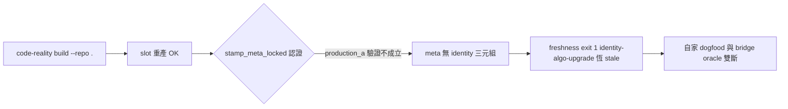

## Description

<!-- SECTION:DESCRIPTION:BEGIN -->
自家 dogfood 斷裂：`code-reality build --repo .` 重產 slot 後 meta 只有 head/producer/repo/selection/stamped_at/tool，缺 source_identity/identity_algo/index_sha256 三元組——freshness 永遠 exit 1 identity-algo-upgrade（codex advisory 在 cf0dc74 就量到，非 CR-4 弧回歸；CR-4 收線後 929e373 重產仍同）。bridge supply v2 的 ④ oracle 在本 repo 自身就是 fail-closed 案例。查 build_repo→stamp_meta_locked 的 production_a 驗證為何在本 repo 不成立（docs mismatch？face scope？），或 stamp 條件過嚴的設計問題。

<!-- SECTION:DESCRIPTION:END -->

## Acceptance Criteria
<!-- AC:BEGIN -->
- [ ] #1 #1 - rust face profile exclude：profile exclude 表對 .rs 生效（walk_sources rust 腿套用）；python 語義零變；凍結測試釘排除後 walk 集不含被排檔
- [ ] #2 #2 - single-root coverage gate：auto 單根也跑 gate，孤兒檔 → exit 2 fail-loud，錯誤訊息帶 walk−index／index−walk 差集（前 N 筆精確路徑）＋兩條修法指引；multi-root 既有 gate 行為不變（既有測試全綠）
- [ ] #3 #3 - stamp 認證差集診斷：認證失敗時 build 報告 note 帶差集路徑（非僅通用 WARN）
- [ ] #4 #4 - 回歵測試（照 codex 設計）：orphan fixture gate fail-loud；profile 排除後 build 得 certified triple＋freshness --json fresh=true；新增孤兒不得靜默過認證；雙 root 對照 fixture
- [ ] #5 #5 - 本 repo dogfood：.code-reality.toml 排除孤兒後 build exit 0＋meta 三元組在場＋freshness --json fresh=true；全倉 cargo test 綠
- [ ] #6 #6 - AGENTS.md Capabilities／相關 skill 面同步（rust profile exclude＋single-root gate 行為）；bridge 無需回信（供給面語義不變，freshness oracle 對 governed repo 更準）
<!-- AC:END -->

## Implementation Plan

<!-- SECTION:PLAN:BEGIN -->
〔baseline：code-reality 929e373（CR-4 後 main）〕

〔已決策勿重辯（雙源調查收斂：codex advisory job-mv20xcrq-784n6x＋marshal 機械 bisect——證據 ai-analysis/2026-10/10-10-cr5-identity-stamp/）：①成因＝walk_sources 把非 Cargo-target 的散落 .rs（本 repo 實例 audit/20260927/evidence/lsp/probe.rs＋tests/fixtures/*.rs）計入 rust 走查集，rust-analyzer scip 只 emit workspace targets → 生產 doc 集 ⊂ 走查集 → stamp 認證 docs==a.docs 恆假 → identity 三元組恆不落、freshness 恆 identity-algo-upgrade stale；single-root auto 模式無 coverage gate（gate_fatal 僅 multi-root/config，build.rs:430-449）故靜默放行；delegate-bridge 倖免＝multi-root gate 在場且當時集合一致 ②嚴格集合相等不放寬（codex #4 採納）：subset/superset 都破消費證據語義 ③rust 走查集獲得 profile exclude 能力（推翻 rust no-profile-filter 舊決策——本弧證據推翻，exclude 語義與 python face 同表），policy-owned exclusion 可達 ④coverage gate 擴及 single-root auto：gate fatal＋錯誤訊息帶 walk−index／index−walk 差集前 N 筆＋修法指引（profile rust exclude 或納入 Cargo target）；既有單根 repo 含孤兒 rs 者 build 將 fail loud——0.x quality-first＋crash-only 哲學接受此行為變更 ⑤stamp 認證失敗的 build 報告帶差集診斷（非僅一句 WARN）⑥本 repo .code-reality.toml 增 rust 排除（audit/ probe.rs 等孤兒）→ 修後本 repo build 應得 certified stamp＋freshness fresh ⑦不從生產 index 反推信任集（codex #2 但書——防靜默 producer 遺漏被認證）〕

〔範圍：profile.rs（exclude 語義擴及 rust face）＋engine.rs walk_sources（rust profile filter）＋build.rs（single-root gate＋認證差集診斷）＋本 repo .code-reality.toml＋回歸測試（source_identity.rs 慣例：orphan fixture gate fail-loud 帶差集／排除後 certified＋fresh／新增孤兒不得靜默過／雙 root 對照）。驗收終點：本 repo build exit 0＋meta 帶 identity 三元組＋freshness --json fresh=true。〕
<!-- SECTION:PLAN:END -->
