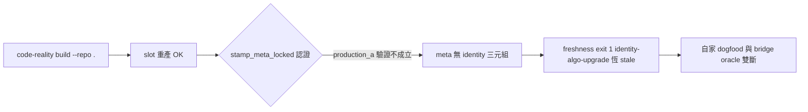

## Description

<!-- SECTION:DESCRIPTION:BEGIN -->
自家 dogfood 斷裂：`code-reality build --repo .` 重產 slot 後 meta 只有 head/producer/repo/selection/stamped_at/tool，缺 source_identity/identity_algo/index_sha256 三元組——freshness 永遠 exit 1 identity-algo-upgrade（codex advisory 在 cf0dc74 就量到，非 CR-4 弧回歸；CR-4 收線後 929e373 重產仍同）。bridge supply v2 的 ④ oracle 在本 repo 自身就是 fail-closed 案例。查 build_repo→stamp_meta_locked 的 production_a 驗證為何在本 repo 不成立（docs mismatch？face scope？），或 stamp 條件過嚴的設計問題。

<!-- SECTION:DESCRIPTION:END -->
