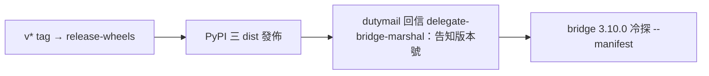
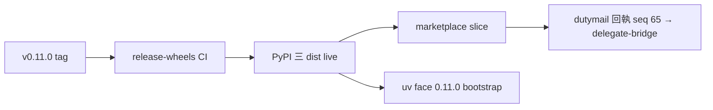

## Description

<!-- SECTION:DESCRIPTION:BEGIN -->
delegate-bridge 回信（db108-cr-converge-ack-001）：六項契約全收、bridge 側定稿——3.10.0 supply v2 將讀 `--manifest`，但會等我方**下一個 PyPI release** 落地後才冷探（uv-installed binary 才有新面；3.9.1 pin hotfix 已出、probe 對有無 manifest 兩態相容）。義務：release 打包時（v* tag → release-wheels 流程）回信 delegate-bridge-marshal 告知版本號。一次性行動，release session 執行。

<!-- SECTION:DESCRIPTION:END -->

## Final Summary

<!-- SECTION:FINAL_SUMMARY:BEGIN -->
0.11.0 已發佈（PyPI 三 dist live＋marketplace slice；release.sh 全鏈綠）——回執寄 delegate-bridge-marshal（cr6-release-notify-0110-001，accepted seq 65）：supply v2 可冷探 --manifest；行為變更提醒（ROOT-09 孤兒 fail-loud／heal Err cooldown）。uv face 四 bin 已 bootstrap 至 0.11.0+26c05f2。

<!-- SECTION:FINAL_SUMMARY:END -->
