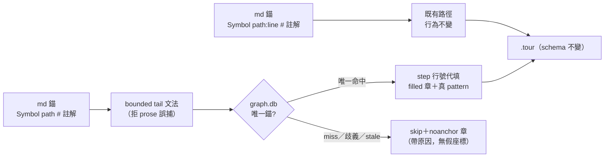

## Description

<!-- SECTION:DESCRIPTION:BEGIN -->
mosaic 的 callstack 文檔錨格式 `Symbol path:line # 註解` 被行號漂移長期折磨——他們實驗證明拔掉行號餵 chain_tour，23 幀全被跳過（noref:23），因為解析器把 `:line` 當必要 token。但管線的 graph.db 重錨機制（same/moved 自動校正）本來就在按符號定位——行號在 md 裡早已是 hint 而非真相源。

本卡讓行號可以省略：`Symbol path # 註解` 也合法，chain_tour 按 symbol+path 查 graph.db 把行號代填進 `.tour`。**顯式行號的行為完全不變**；`.tour` 的 JSON schema 不變。

**不做什麼**：不動 materialize／全域 validate 政策、不做 47 檔遷移（mosaic 自己按族增量）、不擴 graph freshness 共享契約（那是 full EP 門）。

設計已過 codex 對抗審查（2026-10-11，駁回草案兩處：單純 regex optional 會造 line=1 假錨與 prose 誤捕；AIR-80 stale gate 不覆蓋 symbol-only 補錨——收斂版設計全數吸收）。

<!-- SECTION:DESCRIPTION:END -->

## Implementation Plan

<!-- SECTION:PLAN:BEGIN -->
〔baseline：code-reality f3ffefb（main）〕

〔已決策勿重辯：①設計＝codex 對抗審查收斂版（job-mv3uhu62-2qttby verdict，2026-10-11）——line-less 用 bounded tail-position 文法（路徑為幀尾 token、拒副檔名後綴與殘餾 :xxx），禁單純 regex optional；②獨立 line-less 決策分支：唯一同檔 graph 錨＋line>=1＋真 pattern＋repo confinement 才成功（`filled` 章），否則 skip＋`noanchor` 帶原因（graph 不可用／ident 空／歧義／not-in-graph）——禁 line=1 fallback、禁 `ORDER BY ABS(line_start-0)` 盲選、禁以虛構文檔行號算 moved Δ；③symbol-only freshness fail-closed（graph mtime race guard 保留；已知 stale 不得以成功口吻補錨）；④顯式行號 byte-compatible、`.tour` JSON schema 凍結（新增僅 description 文字與 skip 統計）；⑤範圍＝chain_tour.rs（ref_re／parse_frames／新分支／step_of）＋s5_chain_tour.rs；不動 tour.rs／tour_validate.rs／tour_manifest.rs；⑥測試＝codex 14 情境矩陣＋mosaic 23 幀真實樣本（校準語料由 mosaic 提供）〕

範圍限定：本 repo `crates/code-reality/src/chain_tour.rs` 與 `crates/code-reality/tests/s5_chain_tour.rs`；ai-guide 側僅出貨後接線文檔一行更新（非本卡）；mosaic 47 檔遷移非本卡。
<!-- SECTION:PLAN:END -->

## Acceptance Criteria

<!-- SECTION:AC:BEGIN -->
- [ ] line-less bounded 文法落地；regex 負例群（prose 檔名／`.pyc`／`.bak`／`foo.py:abc`／URL／雙 path token）全綠不誤捕
- [ ] line=None 與 Some(0)/負數/巨值分流；無 graph 時 noanchor+reason，全矩陣零 line=1 假 step
- [ ] 唯一同檔 graph 錨才代填（file repo-relative＋line>=1＋非空 pattern＋symbol 一致）；同名多候選＝ambiguous skip，不抽第一個
- [ ] 成功章 `filled`／skip 章 `noanchor(+reason)` 進統計；輸出無虛構 graph+Δ
- [ ] 顯式行號既有 s5 回歸不動全綠（byte-compatible）
- [ ] chain_tour→tour_validate roundtrip 整合測試（獨立比對 file/line/symbol/pattern）＋mosaic 23 幀樣本逐幀核對
<!-- SECTION:AC:END -->

## Implementation Notes

<!-- SECTION:NOTES:BEGIN -->
- 源起：mosaic DRAFT-46（backlog/drafts/draft-46 - chain_tour-支援-symbol-only-錨）＋2026-10-11 傳話；codex 對抗審查 verdict＝`.agent-tmp/draft46-codex-verdict.md`（13.6KB，14 情境測試矩陣全文在檔）
- mosaic 邊界假設修正：解析器是 CR 本體代碼，CR 直接承做，不經 ai-guide session；ai-guide 側僅出貨後文檔一行
<!-- SECTION:NOTES:END -->
