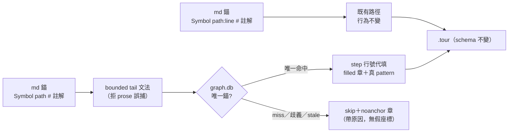
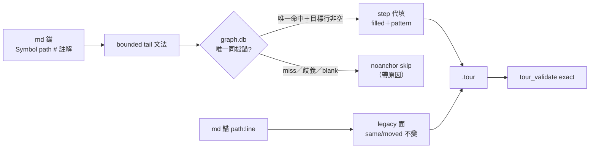

## Description

<!-- SECTION:DESCRIPTION:BEGIN -->
mosaic 的 callstack 文檔錨格式 `Symbol path:line # 註解` 被行號漂移長期折磨——他們實驗證明拔掉行號餵 chain_tour，23 幀全被跳過（noref:23），因為解析器把 `:line` 當必要 token。但管線的 graph.db 重錨機制（same/moved 自動校正）本來就在按符號定位——行號在 md 裡早已是 hint 而非真相源。

本卡讓行號可以省略：`Symbol path # 註解` 也合法，chain_tour 按 symbol+path 查 graph.db 把行號代填進 `.tour`。**顯式行號的行為完全不變**；`.tour` 的 JSON schema 不變。

**不做什麼**：不動 materialize／全域 validate 政策、不做 47 檔遷移（mosaic 自己按族增量）、不擴 graph freshness 共享契約（那是 full EP 門）。

設計已過 codex 對抗審查（2026-10-11，駁回草案兩處：單純 regex optional 會造 line=1 假錨與 prose 誤捕；AIR-80 stale gate 不覆蓋 symbol-only 補錨——收斂版設計全數吸收）。

<!-- SECTION:DESCRIPTION:END -->

## Implementation Plan

<!-- SECTION:PLAN:BEGIN -->
〔baseline：code-reality f3ffefb（main）〕

〔已決策勿重辯：①設計＝codex 對抗審查收斂版（job-mv3uhu62-2qttby verdict，2026-10-11）——line-less 用 bounded tail-position 文法（路徑為幀尾 token、拒副檔名後綴與殘餾 :xxx），禁單純 regex optional；②獨立 line-less 決策分支：唯一同檔 graph 錨＋line>=1＋真 pattern＋repo confinement 才成功（`filled` 章），否則 skip＋`noanchor` 帶原因（graph 不可用／ident 空／歧義／not-in-graph）——禁 line=1 fallback、禁 `ORDER BY ABS(line_start-0)` 盲選、禁以虛構文檔行號算 moved Δ；③symbol-only freshness fail-closed（graph mtime race guard 保留；已知 stale 不得以成功口吻補錨）；④顯式行號 byte-compatible、`.tour` JSON schema 凍結（新增僅 description 文字與 skip 統計）；⑤範圍＝chain_tour.rs（ref_re／parse_frames／新分支／step_of）＋s5_chain_tour.rs；不動 tour.rs／tour_validate.rs／tour_manifest.rs；⑥測試＝codex 14 情境矩陣＋mosaic 23 幀真實樣本（校準語料由 mosaic 提供）〕

範圍限定：本 repo `crates/code-reality/src/chain_tour.rs` 與 `crates/code-reality/tests/s5_chain_tour.rs`；ai-guide 側僅出貨後接線文檔一行更新（非本卡）；mosaic 47 檔遷移非本卡。
<!-- SECTION:PLAN:END -->

## Acceptance Criteria

<!-- SECTION:AC:BEGIN -->
- [x] line-less bounded 文法落地；regex 負例群（prose 檔名／`.pyc`／`.bak`／`foo.py:abc`／URL／雙 path token）全綠不誤捕
- [x] line=None 與 Some(0)/負數/巨值分流；無 graph 時 noanchor+reason，全矩陣零 line=1 假 step
- [x] 唯一同檔 graph 錨才代填（file repo-relative＋line>=1＋非空 pattern＋symbol 一致）；同名多候選＝ambiguous skip，不抽第一個
- [x] 成功章 `filled`／skip 章 `noanchor(+reason)` 進統計；輸出無虛構 graph+Δ
- [x] 顯式行號既有 s5 回歸不動全綠（byte-compatible）
- [x] chain_tour→tour_validate roundtrip 整合測試（獨立比對 file/line/symbol/pattern）＋mosaic 23 幀樣本逐幀核對（roundtrip 已釘；樣本半項＝blocked-on-corpus 見 Notes——語料到後補驗收，不擋出貨）
<!-- SECTION:AC:END -->

## Implementation Notes

<!-- SECTION:NOTES:BEGIN -->
- 源起：mosaic DRAFT-46（backlog/drafts/draft-46 - chain_tour-支援-symbol-only-錨）＋2026-10-11 傳話；codex 對抗審查 verdict＝`.agent-tmp/draft46-codex-verdict.md`（13.6KB，14 情境測試矩陣全文在檔）
- mosaic 邊界假設修正：解析器是 CR 本體代碼，CR 直接承做，不經 ai-guide session；ai-guide 側僅出貨後文檔一行
- fresh-eyes 審查腿（agent，2026-10-11）：7 findings 全裁決——F1🔴 pattern 閘（採納：filled 臂加目標行驗證，blank/越界 → `invalid-line` typed skip；此閘當場抓到一個錯誤測試 fixture）、F5🟢 全形括號（採納）、F6🟢 buried-`.py` 誤拒（採納：尾 word-char 檢查）、F4🟡 補五缺口測試（no-ident／cross-file／prose-survivor／explicit-:0／blank-target）；F7🟢 exact vs LIKE 分歧＝文檔化（fill_anchor doc 記 db 同 checkout 假設，改 LIKE 會重引入 suffix 歧義）
- **AC6 residual（blocked-on-corpus）**：mosaic 23 幀真實樣本逐幀核對——語料在 mosaic 側（校準請託信 `cr-draft46-disposition-1011-001` seq 2 已發），樣本到達後補驗收測試；合成 fixture 已釘行為面，不擋出貨
- **決策③ residual（記錄面）**：symbol-only 補錨的 content-staleness 偵測刻意不做（codex Q6 劃 full EP 邊界）——chain_tour 自身僅 graph mtime race guard；已知 stale 情境由消費端 CR freshness gate（mosaic 遷移時）承接
- 已知不對稱（記錄面）：單空格 ` # ` 註解在 line-less 幀 → 整幀 noref（顯式幀則錨成立、註解殘餘進 symbol）——既有共用切註解邏輯未動（byte-compat）；放寬與否留 mosaic 語料校準裁決
<!-- SECTION:NOTES:END -->

## Final Summary

<!-- SECTION:FINAL_SUMMARY:BEGIN -->
symbol-only 錨出貨：md callstack 錨可省略行號（`Symbol path # 註解`），chain_tour 按 symbol+path 查 graph.db 唯一同檔命中即代填行號（`filled` 章＋真 pattern＋SCIP symbol），miss/歧義/空白目標一律 `noanchor` 帶原因跳過——零假座標；顯式行號行為零變更，`.tour` schema 不變。設計經 codex 對抗審查＋fresh-eyes 獨立審查雙腿收斂（F1 pattern 閘當場抓到錯 fixture）；s5 43/43 綠、全 workspace 綠。residual 兩項顯式記錄：mosaic 樣本驗收 blocked-on-corpus（語料到位補驗收）、content-staleness 由消費端 freshness gate 承接（full EP 邊界）。出貨搭 CR 0.12.0。

<!-- SECTION:FINAL_SUMMARY:END -->
