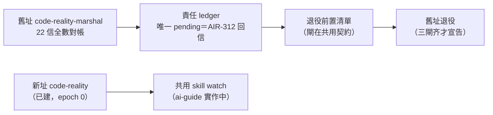
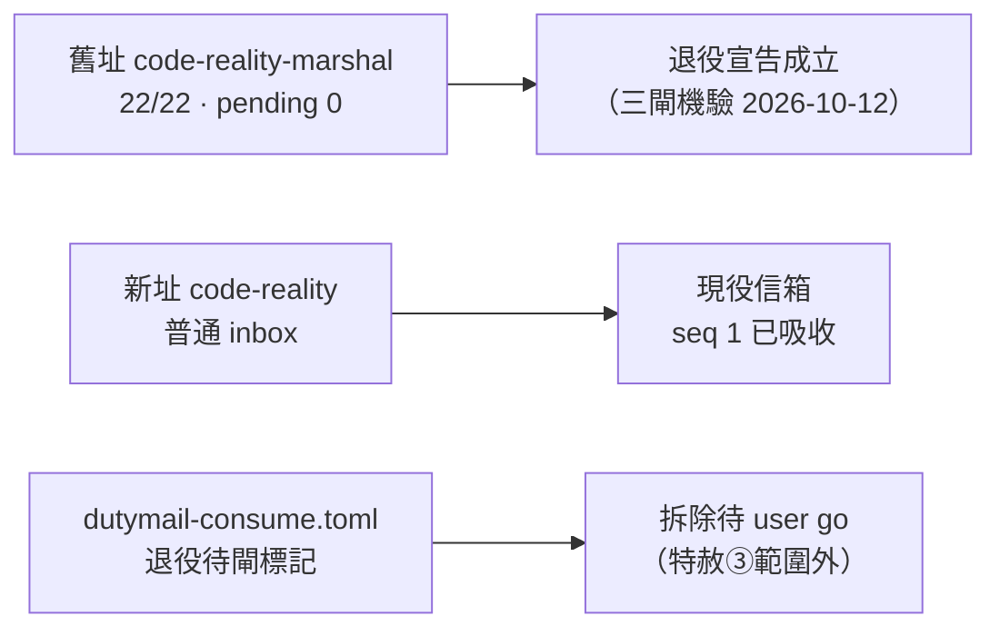

## Description

<!-- SECTION:DESCRIPTION:BEGIN -->
AIR-312 新信箱慣例：一 repo 一信箱（alias＝repo name），本 repo 新址 `code-reality` 已由 AIR-312 建立在场（addressId 7af5be6b，epoch 0、零信——不重建）。本卡＝本 repo 側對接：舊址 `code-reality-marshal` 的責任對帳、待回覆 ledger、與退役前置清單。

**不做什麼**：不重建地址、不轉寄歷史信成新 envelope、不自行實作共用 skill（ai-guide 承做）、不猜 bridge 未定 CLI（歷史讀信入口 bridge 評估中）、不搶 holder binding（唯讀對帳）。

退役閘＝sender 切換＋共用 skill 落地＋bridge 歷史讀取入口三者齐，非本卡單方可閉。

**結案（2026-10-12）**：三閘機驗通過、舊址退役宣告成立；新址普通 inbox 啟用（首封信已吸收）。殘餘＝`governance/dutymail-consume.toml` 拆除待 user go（結案特赦僅及 backlog/）。

<!-- SECTION:DESCRIPTION:END -->

## Acceptance Criteria

<!-- SECTION:AC:BEGIN -->
- [x] 舊址 22 信全數對帳（thread 狀態 ledger 見 Notes）
- [x] 待回覆識別：seq 22（AIR-312 solicit，envelope 0f4211ac）為唯一 pending——回覆文字已交付 user（暫回 ai-guide-marshal，寄送待 user）
- [x] consume config 標記 AIR-312 退役待閘（機器仍 active，共用 skill 落地前不可拆）
- [x] 舊址退役宣告（三閘 2026-10-12 機驗通過，證據見 Notes——宣告成立）
<!-- SECTION:AC:END -->

## Implementation Plan

<!-- SECTION:PLAN:BEGIN -->
〔baseline：code-reality main @ f2bb8bb〕

〔已決策勿重辯：①一 repo 一信箱、alias＝repo name（`code-reality` 已建不重建）；②普通 inbox 模型——讀完標 read、原信保留、只記待回覆；③信中工作走既有任務卡、無五態信件工作流；④共用處理信 skill 主動呼叫（watch/stop），退役值星自動 hook、consume config、exceptions 分流；⑤不另造 session registry／協調服務；⑥sender 切換與在飛回信歸屬確認前不宣稱舊址退役〕

範圍限定：本 repo 只動 `governance/dutymail-consume.toml`（標記退役待閘）與本卡；歷史卡／EP 內的 dutymail 引用＝歷史紀錄不回寫。依賴外部：共用 skill（ai-guide AIR-312 實作中）、bridge ACK 後歷史讀信入口（bridge 評估中）——兩者落地前本 repo 無單方可做的退役動作。
<!-- SECTION:PLAN:END -->

## Implementation Notes

<!-- SECTION:NOTES:BEGIN -->
**舊址 thread ledger（22 信，2026-10-12 對帳）**：

| seq | thread | 狀態 |
|---|---|---|
| 1-13 | db100-era bridge 往返 | 閉（CR-3 Done；legacy 兩信由 bridge seq 16 settlement 結案） |
| 14 | bridge 冷探回執（CR-6） | 閉（CR-6 卡記錄，commit 1040833） |
| 15 | southchariot supply solicit | 閉（雙回執 37/39＋對方 loop-close seq 18） |
| 16 | bridge 台帳 settlement | 閉（inform，兩 legacy 信結案） |
| 17/19 | bridge DB-111 進度＋完成 | 閉（bridge 3.10.6 出貨） |
| 18 | southchariot 迴路收口 | 閉（對方宣告無未決） |
| 20 | AIR-310 provisioning 回執 | 閉（後續已被 AIR-311/312 演進取代） |
| 21 | mosaic 校準語料 | 閉（我方驗收回執 mosaic seq 5；0.12.1 出貨） |
| **22** | **AIR-312 通知（solicit）** | **唯一 pending——回覆文字已交 user，寄送待 user；回址暫 ai-guide-marshal** |

- 我方 outbound 六 thread 全數有對方回音或 closure（bridge 65→14；supply 37/39→18；handoff 71→19；provision-request 71→20；draft46 2/3→21；landing 73→對方 draft-13 notes 認收）。
- holder 現況（唯讀）：bindingEpoch 4 bound、cursor 21/22、pending 1——bound≠carrier 活著，未做 takeover/release。
- 憑證面：本 repo `governance/dutymail-consume.toml`（AIR-311 provisioning，commit 13ac689）仍為 duty_receive 活機制；AIR-312 退役須等共用 skill 接管收信面。
- 新址 `code-reality`（7af5be6b）：epoch 0、零信——共用 skill watch target。
- **pending 項閉環（2026-10-12）**：seq 22 回覆文字經 user 轉貼交付（manual paste，無 message_id——semantic ACK 免 formal receipt）；transport cursor 22/22、pending 0（普通 inbox 模型：已讀、原信保留）。殘餘＝退役三閘（外部契約），見 AC 最後一項。

- **AIR-312 落地通知吸收＋舊址退役宣告（2026-10-12）**：收新址 `code-reality` 首封信（seq 1、envelope 2182a50b、ai-guide-marshal coordination/inform 免回信，已 mark-read）。退役三閘全數機械驗證：①共用 skill 落地＝mail-handle 已部署、本 session 實用（pending-replies/inbox/show/mark-read 全通）；②bridge 歷史入口＝tokenless 唯讀面在場，`dutymail mail list --address code-reality-marshal --box pending` 實測 `{items:[], primaryCursor:22}`；③sender 切換＝我方 outbound 六 thread 全數閉（上表），新信/reply_address 起改寄 repo basename 新址。舊址機械狀態：pendingCount=0、cursor 22/22（bridge_mail_status；bindingEpoch 4 唯讀不動）。
- **殘餘（特赦③範圍外）**：`governance/dutymail-consume.toml` 拆除＝一次 `git rm`＋commit，待 user 點頭；拆除後 duty_receive process 對本 repo 即 deny-all fail-loud（期望終態），檔現存亦無消費路徑（process 受 skill 紅線禁用）。
<!-- SECTION:NOTES:END -->

## Final Summary

<!-- SECTION:FINAL_SUMMARY:BEGIN -->
舊址 code-reality-marshal 退役宣告成立（三閘機驗：共用 skill 落地、tokenless 歷史讀取面、sender 切換；對帳 22/22 pending 0），新址 code-reality 普通 inbox 啟用並吸收首封信；殘餘＝governance/dutymail-consume.toml 拆除待 user go。

<!-- SECTION:FINAL_SUMMARY:END -->
