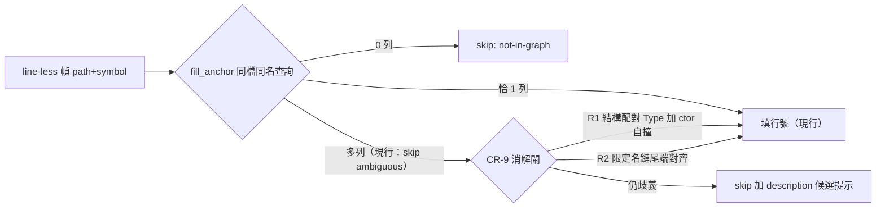
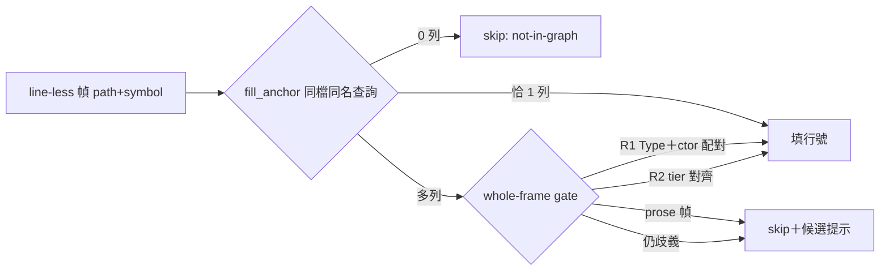

## Description

<!-- SECTION:DESCRIPTION:BEGIN -->
**mosaic MOS-190 回報：全庫 225 tours 的殘餘跳步中，「同檔同名」ambiguous 佔真實痛點——三個類都有 execute 方法（真歧義，文檔其實寫了限定名）與 class＋建構子節點自撞（假歧義，同一實體鑄兩節點）都被跳過。本卡讓 chain_tour 在 fail-closed 前提下：能確定的就填行號（R1 結構配對／R2 限定名對齊），不能確定的就在 tour description 列候選提示（R3），讓文檔作者補顯式行號。**不做**：跨檔推斷、nearest-line 盲選、explicit-line 錨面變更、Rust `::` 文法、producer/schema 變更。

**規矩**
- CR-7 adversarial AC 明文修訂（addendum）——不得以「相容」含糊合入
- 三規則只在既有同檔同名候選集內收窄，永不新增錨點來源
- mosaic 以新版重跑 225 tours＝外部驗收證據

<!-- SECTION:DESCRIPTION:END -->

## Acceptance Criteria
<!-- AC:BEGIN -->
- [x] #1 - R1：Type＋pseudo-ctor 自撞形（Plain/Greeter 型＋嵌套 Type 型）→ 填 class 行且 x-codeReality.symbol＝Type 本尊；三組反例（Type＋異行同名 fn／同行非配對節點／nested-fn 無 ctor）仍 ambiguous（fixtures 釘）
- R2：doc 帶限定名（`DataPhaseStep.execute` 對三類同名方法）→ 恰一存活填行號；`Outer.A.execute` 完整鏈 → 填；限定無候選符／雙候選符／bare 名多法仍 ambiguous（fixtures 釘）
- R3：殘餘 ambiguous 幀在 tour description 末尾獨立行列候選（≤4/幀、≤3 幀/scenario＋剩餘計數，帶 kind 與行號，非 path:line 形）；無歧義 tour 的 description 零變化；g_counts ambiguous 鍵語義不變
- CR-7 addendum：doc-comment 修訂落地＋對抗 fixture（無限定資訊仍 fail-closed）在場
- Rust impl#[Lab]/[WsLab] 雙括號形有正例 fixture；explicit-line 錨面輸出不變有釘
- 全量 `cargo test` 綠；既有 boot#1/#2 守門例不動
- 分段 commit 落地（R1+R3／R2），git diff 範圍限指定檔案
<!-- AC:END -->

## Implementation Plan

<!-- SECTION:PLAN:BEGIN -->
〔baseline：code-reality f2281bb〕

〔已決策勿重辯：①方向＝做——顧問雙腿收斂（muse wonder job-mv6qlxka-35tmbw／codex web job-mv6qlxhh-i2wevo，意見全文存 .agent-tmp/mos190/）＋主 session arch-thinking 裁決。②fail-closed 不變——三規則全部只在既有 same-file same-name 候選集內收窄，永不新增錨點來源。③R1＝pseudo-constructor 身分配對 collapse（非 kind 計數）：候選集恰為 {Type \`X#\`, pseudo-ctor \`X().\`} 二元組——ctor symbol 須恰為 \`pseudo_ctor_symbol(Type symbol)\`（pyrefly-producer/src/symbol.rs:89 尾 \`#\`→\`().\`）且兩節點 line_start 相等且無其他同名候選；任一條件不滿足→維持 ambiguous；填入 x-codeReality.symbol 的是 Type 本尊（canonicalization 須在 addendum 註明，不宣稱兩 SCIP symbol 等價）；R1 事實上面＝Python/JS-TS（Rust Type# 不入 queryable 集，engine.rs:99-116）。④R2＝descriptor-aware scope chain 尾端對齊（禁通用分隔器切末段）：從候選 SCIP symbol 擷取結構化 scope chain（先切 descriptor 區——最後一個 \`\` `/ \`\` module 段之後；Rust trait impl 取第一括號組＝inherent type），doc token 從 best_ident 勝出 token 的完整點分形正規化（best_ident 須同時回傳勝出 token）；比對＝doc 鏈與候選鏈尾段逐段整段字串相等（禁 ends_with 子字串、case-sensitive）；兩 tier：tier-1＝同長全等優先、tier-2＝無 tier-1 存活時允許短鏈尾對齊；任一 tier 恰一存活才填，零/多存活或 descriptor 無法解析→ambiguous。⑤R3＝NoAnchor 帶 candidates 欄位（reason 字串維持 "ambiguous" 供 g_counts 穩定）；呈現＝tour description 末尾獨立行固定前綴（歧義候選：），渲染 descriptor＋行號＋kind 後綴，禁製造會被 tour_validate 檔案引用統計誤認的 path:line 形；上限每幀 take 4、每 scenario 詳列 ≤3 幀其餘摺疊為計數並明示剩餘數；排序 ORDER BY line_start,symbol。⑥CR-7 addendum＝chain_tour.rs:554-557 doc-comment 明文修訂（採 codex 擬詞方向：多節點僅在獨立驗證為同一邏輯定義、或文檔限定名唯一指認時可消解，否則 fail closed）＋保留原三禁＋封閉候選集前提＋filled 計數預期位移註記＋對抗 fixture（無限定資訊仍 ambiguous）。⑦non-goals（另弧）：explicit-line anchor() 面、Rust \`::\` 文法、overload 語義、\`$\` 分隔器、producer/schema 變更。⑧fixtures 須種真實 SCIP 形 symbol（seed_node 需補 kind 參數，graph_db_fixture.rs）；必備組＝R1 正例（Plain/Greeter 型＋嵌套 Type）＋R1 反例三組（Type＋異行同名 fn／同行非配對節點／nested-fn 無 ctor）＋R2 正例（A.execute 對雙類同名法→填 A；Outer.A.execute 完整鏈）＋R2 反例（限定無候選符／雙候選符／bare 名多法）＋Rust impl#[Lab]/[WsLab] 正例＋trait impl 無唯一證據 ambiguous＋R3 上限渲染＋既有 boot#1/#2 保留為無消解資訊守門例＋explicit-line 輸出不變釘。⑨變更檔案限 crates/code-reality/src/chain_tour.rs＋tests（s5_chain_tour.rs、graph_db_fixture.rs）。⑩CorporateAction 屬推判同型未驗 mosaic db——fixtures 不宣稱解之；外部驗收＝mosaic 以新版重跑 225 tours。⑪分段 commit：R1+R3 一段、R2 一段（耦合不可避免時合併須 notes 記理由）。〕

實作派工：bridge glm --write-mode edit --yolo 卡級 worktree；工單由本卡 Plan＋AC 拼裝，機械驗證＝cargo test 全量＋git diff 範圍檢查。
<!-- SECTION:PLAN:END -->

## Implementation Notes

<!-- SECTION:NOTES:BEGIN -->
deep-work 值星進度（sess_d22cd132）：顧問雙腿收斂（muse job-mv6qlxka-35tmbw／codex job-mv6qlxhh-i2wevo——R1/R2 修訂形全吸收進 Plan）→ 實作腿 GLM-5.3-Flash job-mv6r479v-nav5a2 verdict done（WT code-reality-cr-9 working tree 交付、未 commit；chain_tour.rs +339/-44＋s5_chain_tour.rs +801；graph_db_fixture.rs 未動＝seed_node 實居 s5 檔、make_graph_db 已支援 kind——准改清單上限非必改）→ 主 session 機驗：clean-env 全量 cargo test exit 0＋scoped s5 53/53 綠。回信 mosaic 已發（cr9-decision-220944c，AUTH 決定好後回信已消費；附樣本清單請求＋外部驗收請求）。在飛：fresh-eyes＋primed 雙審查；下一步：judge→修正→分段 commit（R1+R3／R2，best_ident 簽名耦合已預授權合併）→settle

settle（sess_d22cd132）：judge 裁決後修補腿 job-mv6tthpl-hqbjsv 落地（addendum 精確化＝bare token 只經 R1 或 tier-1 精確全鏈填入永不經 tier-2＋R3 註解歸因修正＋descriptor_chain 註解如實化＋三支邊界 fixtures：bare-tier-1 頂層 fn 釘／module 限定 token ambiguous／a..b 空段 ambiguous）。最終機驗：clean-env 全量 cargo test exit 0、70 test targets、708 passed / 0 FAILED；clippy 零新增；fmt 新碼 0 diff。commit 5795aad 已 ff-merge 進 main（單一 commit——Plan ⑪ 合併例外成立：fill_anchor 簽名/體 R1 與 R2 交織，事後切分需虛構未測中間態）。雙審查 finding 全數收斂：fresh F1/F2/F3 採納（F4①③併入修補、②④⑤由 addendum 文檔化涵蓋）、primed F1 同點裁決採 fresh① 方案（不加 qualified-only 閘——精確全名匹配＝證據型消解）、primed F2/F3 採納。卡片狀態留 In Progress——Done 翻牌歸 user（AIR-200）。後續（user 點頭後）：release 弧吸收 plugin skill chain_tour 行為文檔＋版號鎖步；mosaic 以新版重跑 225 tours＝外部驗收

mosaic 樣本清單已收（mos-190-cr9-samples，2026-10-14）：①CorporateAction 確認為唯一 R1 形（Type＋pseudo-ctor 同檔）——我方推判被發送方證實；②R2 形＝Step.execute 家族（22+ class 同檔）＋get_symbols×3／to_polars_exp／from_dict×2／__init__×2／run×2 等嵌套形——皆限定名可解；③裸重名（main／get_segments／_category／INDEX_CODES 等）＝R3 提示後人工補行號預期終態；④越界警示：tour headers 混 prose 敘事幀——不得進 R2 descriptor 解析（我方現行：無 path 幀走 noref、有 path 而 token 不符走 not-in-graph／ambiguous+hint，兩路皆 fail-visible，合於其建議）；⑤對方承諾 CR-9 發佈後重跑 225 tours 回報 R1/R2 殘餘消除與 R3 提示樣態＝外部驗收。信已讀（原信 show --envelope-id mos-190-cr9-samples 可重看）；無待回覆義務——後續回信需新 AUTH

outbound 台帳：發佈通知信 cr9-release-notify-073233 已受理（acceptanceSeq=3，thread=re mos-190-cr9-samples，intent=inform）——AUTH: user said「寄信」（2026-10-14，回應寄信徵詢）。內容＝v0.13.0 發佈＋CR-9 上線清單＋prose gate 說明＋升級路徑＋外部驗收開跑請求
<!-- SECTION:NOTES:END -->

## Final Summary

<!-- SECTION:FINAL_SUMMARY:BEGIN -->
CR-9 落地：chain_tour 同檔同名歧義消解三規則（R1 建構子結構配對／R2 限定名 scope-chain tier 對齊／R3 候選提示）＋whole-frame prose gate＋CR-7 addendum；跨家族審查（muse approve／codex needs-fix 三項全採納修復）；711 tests 綠；commits 5795aad→d0c2002 進 main。mosaic 樣本清單對照無越界形；外部驗收待其新版重跑 225 tours。

<!-- SECTION:FINAL_SUMMARY:END -->
